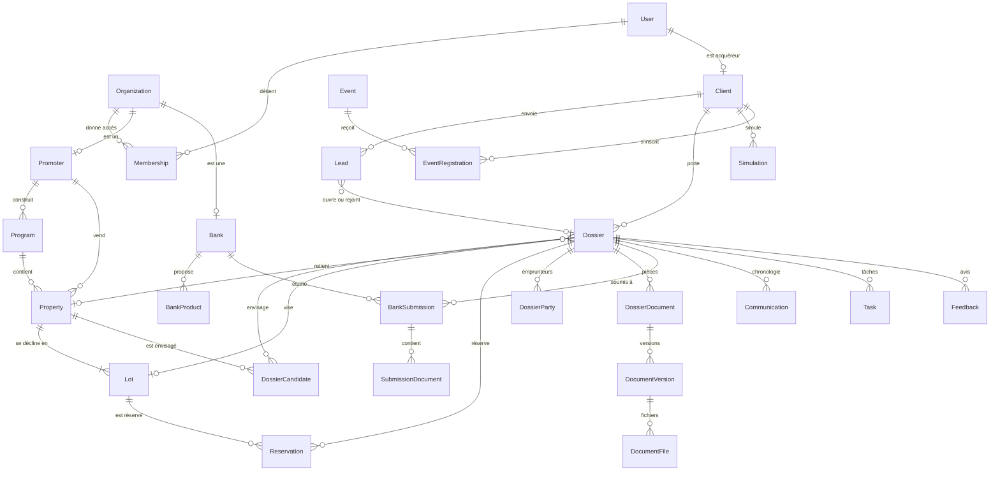

# Modèle de données — conventions, vue d'ensemble, énumérations

Ce fichier pose les règles communes à toutes les tables, donne la carte des entités et liste **toutes les énumérations** avec leur libellé français. Le détail des tables est dans les fichiers `02` à `05` de ce dossier.

Le schéma Prisma (`apps/api/prisma/schema.prisma`) est écrit d'après ces fichiers. L'ancien brouillon `Dev/db/schema.prisma` est **remplacé** : il ne doit plus servir de base.

---

## 1. Conventions

**MOD-001** `[P1]` Base **PostgreSQL 16**. Extensions requises : `citext` (e-mails insensibles à la casse), `pg_trgm` (recherche tolérante), `unaccent` (recherche sans accents), `pgcrypto`.

**MOD-002** `[P1]` **Nommage.** Modèles Prisma en `PascalCase` singulier anglais (`Dossier`, `BankSubmission`). Tables en `snake_case` pluriel (`dossiers`, `bank_submissions`) via `@@map`. Champs en `camelCase` dans Prisma, colonnes en `snake_case` via `@map`. Énumérations en `PascalCase`, valeurs en `SCREAMING_SNAKE_CASE`. Seule exception : `Locale`, dont les valeurs sont les codes de langue BCP 47 en minuscules (`fr`, `ar`, `en`), tels qu'ils figurent dans les adresses et dans les paramètres (`i18n.activeLocales`).

**MOD-003** `[P1]` **Clé primaire** : `id`, UUID version 7, générée par l'application. Exceptions : `Country` (code ISO sur deux lettres), `Setting` (clé texte), et les tables à **clé composée**, sans `id` : `PropertyDailyStat` (`propertyId`, `day`), `Favorite` (`clientId`, `propertyId`), `AlertDelivery` (`alertId`, `propertyId`), `Sequence` (`name`, `scope`), `SavedViewDefault` (`userId`, `listKey`).

**MOD-004** `[P1]` **Horodatage.** Toute table a `createdAt` et `updatedAt` (`timestamptz`, UTC). Les tables de journal (immuables) n'ont que `createdAt`. Ces colonnes, comme tout horodatage, sont écrites **par l'application** d'après `Clock` (ARC-060) : aucune colonne n'a pour valeur par défaut l'heure de la base (`now()`), sans quoi l'horloge de recette (ENV-032) ne s'appliquerait pas aux dates enregistrées.

**MOD-005** `[P1]` **Auteur.** Les tables modifiables depuis le back-office ont `createdById` et `updatedById` (vers `User`, nuls pour le système). Le détail des changements est dans `AuditLog`.

**MOD-006** `[P1]` **Suppression logique.** Les tables marquées « ⌫ » ont `deletedAt`. Toutes les requêtes excluent par défaut les lignes où `deletedAt` n'est pas nul (filtre global de l'ORM). Les contraintes d'unicité de ces tables sont des index **partiels** (`WHERE deleted_at IS NULL`).

Deux tables non marquées ont un `deletedAt` **hors** de cette convention : il y marque un état, pas un passage à la corbeille. Le filtre global ne s'y applique pas, elles ne figurent pas dans la corbeille (ADM-070) et ne se restaurent pas. `DocumentVersion` : une version supprimée reste dans l'historique de sa pièce, avec sa mention (GED-080, CYC-149). `WorkflowRule` : une règle supprimée ne s'exécute plus, et reste lisible depuis son journal (AUT-004). De même, `Message` (⌫) ne passe pas par la corbeille, et le fil d'une conversation lit aussi ses messages supprimés, pour afficher « Message supprimé » à leur place (MOD-401).

**MOD-007** `[P1]` **Verrouillage optimiste.** Les tables marquées « ⟳ » ont `version` (entier, 1 à la création). Toute modification **faite par une personne** (formulaire, action d'écran) envoie la version lue et l'incrémente ; si elle ne correspond plus, la mise à jour échoue (`CONFLICT_VERSION`, TRV-094). Les écritures **du système** sur la même ligne — caches (MOD-014), compteurs, `lastActivityAt`, échéances recalculées, compteurs de relance, effets d'une tâche planifiée — **ne touchent pas** `version` : un conseiller qui modifie un plan de financement pendant que le client dépose une pièce n'est pas refusé. Ces écritures mettent à jour leurs seules colonnes, par une requête qui ne relit pas le reste de la ligne.

**MOD-008** `[P1]` **Argent.** Un montant = deux colonnes : la valeur en `Decimal(14,2)` et la devise en `Char(3)` (code ISO 4217). Jamais de nombre flottant. Jamais de montant sans devise, sauf quand la devise est portée par le parent (le prix d'un lot suit la devise de son bien).

**MOD-009** `[P1]` **Taux et pourcentages.** Les taux d'intérêt et marges sont des entiers en **points de base** (`550` = 5,50 %), champs suffixés `Bps`. Les autres pourcentages sont en `Decimal(5,2)`, champs suffixés `Pct` (`20.00`).

**MOD-010** `[P1]` **Durées** : en mois (`Int`, suffixe `Months`), en jours (`Days`), en heures (`Hours`), en minutes (`Minutes`).

**MOD-011** `[P1]` **Téléphones** au format E.164, `Varchar(20)`. **Pays** en ISO 3166-1 alpha-2, `Char(2)`. **Langue** : énumération `Locale`. **Fuseau** : nom IANA (`Europe/Paris`), `Varchar(64)`.

**MOD-012** `[P1]` **Champs JSON.** Chaque colonne `Json` a un schéma décrit dans ces specs et validé par l'application à l'écriture. Une colonne JSON ne porte jamais une donnée que l'on filtre ou trie souvent ; celle-ci a sa colonne.

**MOD-013** `[P1]` **Clés étrangères.** Toutes les relations ont une contrainte en base. Comportement à la suppression, sauf mention contraire : `RESTRICT`. On ne supprime pas un parent qui a des enfants : on l'archive. `CASCADE` est réservé aux enfants sans existence propre (contacts d'un promoteur, lignes d'une liste de pièces). Exception : `WorkflowExecution.triggerEventId` n'a pas de contrainte, parce que l'événement est purgé avant l'exécution (AUT-091).

**MOD-014** `[P1]` **Caches.** Un champ marqué « (cache) » est recalculé par l'application dans la **même transaction** que le changement qui l'affecte. Une tâche planifiée de contrôle le recalcule chaque nuit et signale tout écart (`01-domaine/08`, AUT-090).

**MOD-015** `[P1]` **Index.** Chaque clé étrangère est indexée. Les index supplémentaires sont listés par table. Les colonnes de recherche textuelle ont un index GIN par trigrammes sur leur forme sans accents.

**MOD-016** `[P1]` **Chiffrement applicatif.** Les champs marqués « 🔒 » sont chiffrés par l'application avant écriture (AES-256-GCM, clé hors base) : le secret de double authentification. Les mots de passe, les jetons et les **codes** (code d'accès d'un partage, code de confirmation d'une action) sont **hachés**, jamais chiffrés : on ne peut pas les relire, seulement les comparer (`06-technique/03`).

**MOD-017** `[P1]` **Données de phases ultérieures.** Les tables et champs étiquetés `[P1]`, `[P2]`, `[P3]`, `[MOB]`, `[IA]` sont **créés dès la première migration**. Seuls leurs écrans et leurs routes attendent.

**MOD-019** `[P1]` **Unicité et colonnes facultatives.** PostgreSQL tient deux valeurs nulles pour différentes : une contrainte d'unicité ne protège donc pas une colonne vide. Deux cas, toujours écrits explicitement dans le schéma :
- unicité d'une colonne facultative **seule** (`Client.email`, `Client.userId`, `Task.dedupeKey`) : elle ne vaut que pour les valeurs renseignées (index partiel) ;
- clé **composée** dont une colonne peut être vide : la colonne vide compte comme une valeur (`NULLS NOT DISTINCT`). Sont concernées : `DossierDocument` (`dossierId`, `partyId`, `code`) · `Conversation` (`clientId`, `dossierId`, `partnerOrganizationId`) · `SurveyInvitation` (`surveyId`, `clientId`, `dossierId`, `eventId`) · `EventNotifyRequest` (`email`, `eventId`, `locationLabel`) · `Sequence` (`name`, `scope`).

Toute nouvelle contrainte de ce genre s'ajoute à cette liste (FIA-002).

## 2. Carte des entités

| Contexte | Entités | Fichier |
|---|---|---|
| Identité et accès | `User`, `Organization`, `Membership`, `Session`, `AuthToken`, `Consent`, `PushDevice` | `02` |
| Référentiels | `Country`, `Region`, `City`, `TravelTime`, `ExchangeRate`, `Holiday` | `02` |
| Partenaires | `Promoter`, `PromoterContact`, `Bank`, `BankContact`, `BankProduct`, `Partner`, `PartnerDocument`, `PartnerAnswer` | `02` |
| Catalogue | `Program`, `Property`, `Lot`, `Media`, `PropertyPoi`, `ProgramUpdate`, `FinancingEligibility`, `SlugHistory`, `PropertyDailyStat` | `03` |
| CRM | `Client`, `ClientContact`, `Lead`, `Favorite`, `SearchAlert`, `AlertDelivery`, `Note` | `04` |
| Dossiers | `Dossier`, `DossierParty`, `DossierStageHistory`, `DossierCandidate`, `Reservation`, `Appointment` | `04` |
| Pièces | `ChecklistTemplate`, `ChecklistItem`, `DossierDocument`, `DocumentVersion`, `DocumentFile`, `DocumentReminder` | `04` |
| Financement | `BankSubmission`, `SubmissionDocument`, `SubmissionPackage`, `SecureShare`, `BankSubmissionEvent`, `Simulation` | `04` |
| Communication | `EmailTemplate`, `EmailTemplateVersion`, `Communication`, `MailWebhookEvent`, `Conversation`, `Message`, `MessageAttachment`, `Notification`, `NotificationPreference`, `WorkflowRule`, `WorkflowExecution`, `Task` | `05` |
| Satisfaction | `Survey`, `SurveyInvitation`, `Feedback` | `05` |
| Le Café | `Event`, `EventPartner`, `EventRegistration`, `EventNotifyRequest` | `05` |
| Contenus | `ContentBlock`, `Page`, `FaqItem`, `Testimonial`, `LegalDocument`, `Redirect`, `Translation` | `05` |
| Plateforme | `Setting`, `AuditLog`, `OutboxEvent`, `IdempotencyKey`, `Sequence`, `DataRequest`, `ImportJob`, `ExportJob`, `SavedView`, `SavedViewDefault`, `JobRun`, `Upload` | `05` |

### 2.1 Schéma d'ensemble

### 2.2 Liste des entités

Légende : ⌫ suppression logique · ⟳ verrouillage optimiste.

| Entité | Rôle en une ligne | Phase | Marques |
|---|---|---|---|
| `User` | Compte de connexion | P1 | |
| `Organization` | Opérateur, promoteur ou banque en tant qu'organisation d'accès | P1 | |
| `Membership` | Rôle d'un compte dans une organisation | P1 | |
| `Session` | Session ouverte (jeton de renouvellement) | P1 | |
| `AuthToken` | Jeton à usage unique (vérification, mot de passe, connexion) | P1 | |
| `Consent` | Preuve d'un consentement | P1 | |
| `PushDevice` | Appareil mobile enregistré pour les notifications | MOB | |
| `Country` | Pays (résidence, catalogue) | P1 | |
| `Region` | Région d'un pays (wilaya en Algérie) | P1 | |
| `City` | Ville ou commune d'une région | P1 | |
| `TravelTime` | Temps de vol d'une ville de résidence vers une région | P1 | |
| `ExchangeRate` | Cours de change daté | P1 | |
| `Holiday` | Jour férié du calendrier de travail | P1 | |
| `Promoter` | Promoteur immobilier | P1 | ⌫ ⟳ |
| `PromoterContact` | Interlocuteur chez un promoteur | P1 | |
| `Bank` | Banque | P1 | ⌫ ⟳ |
| `BankContact` | Interlocuteur dans une banque | P1 | |
| `BankProduct` | Produit de financement, barème | P1 | ⌫ ⟳ |
| `Partner` | Autre partenaire présenté publiquement | P1 | ⌫ |
| `PartnerDocument` | Document d'un promoteur ou d'une banque (agrément, convention) | P1 | ⌫ |
| `PartnerAnswer` | Réponse donnée par un partenaire lui-même, par lien ou dans le portail (`00-cadre/06`) | P2, P3 | |
| `Program` | Programme immobilier | P1 | ⌫ ⟳ |
| `Property` | Bien (typologie ou bien isolé) | P1 | ⌫ ⟳ |
| `Lot` | Unité vendue | P1 | ⌫ ⟳ |
| `Media` | Fichier média | P1 | ⌫ |
| `PropertyPoi` | Point d'intérêt proche d'un bien | P1 | |
| `ProgramUpdate` | Point d'avancement d'un chantier | P1 | ⌫ |
| `FinancingEligibility` | Acceptation d'un programme ou d'un bien par une banque | P1 | |
| `SlugHistory` | Anciennes adresses d'un objet public | P1 | |
| `PropertyDailyStat` | Vues et intérêts d'un bien, par jour | P1 | |
| `Client` | Fiche CRM d'un acquéreur | P1 | ⌫ ⟳ |
| `ClientContact` | Personne de confiance d'un client | P1 | |
| `Lead` | Demande entrante | P1 | |
| `Favorite` | Bien mis en favori | P1 | |
| `SearchAlert` | Alerte de recherche | P1 | |
| `AlertDelivery` | Bien déjà envoyé pour une alerte | P1 | |
| `Note` | Note interne | P1 | ⌫ |
| `Dossier` | Projet d'acquisition | P1 | ⌫ ⟳ |
| `DossierParty` | Emprunteur, co-emprunteur, garant | P1 | ⟳ |
| `DossierStageHistory` | Historique des étapes | P1 | |
| `DossierCandidate` | Bien envisagé dans un dossier | P1 | ⟳ |
| `Reservation` | Option ou réservation d'un lot | P1 | ⟳ |
| `Appointment` | Rendez-vous | P1 | ⟳ |
| `ClientTimelineEntry` | Ligne du suivi d'un dossier tel que le client le voit (ECL-031) | P1 | |
| `ChecklistTemplate` | Modèle de liste de pièces | P1 | ⌫ |
| `ChecklistItem` | Ligne d'un modèle | P1 | |
| `DossierDocument` | Pièce d'un dossier | P1 | ⟳ |
| `DocumentVersion` | Version d'une pièce (un dépôt) | P1 | |
| `DocumentFile` | Fichier d'une version de pièce | P1 | ⌫ |
| `DocumentReminder` | Relance de pièces d'un dossier | P1 | |
| `BankSubmission` | Soumission d'un dossier à une banque | P1 | ⟳ |
| `SubmissionDocument` | Pièce jointe à une soumission | P1 | |
| `SubmissionPackage` | Paquet généré pour une soumission | P1 | |
| `SecureShare` | Lien de téléchargement sécurisé | P1 | |
| `BankSubmissionEvent` | Événement d'une soumission | P1 | |
| `Simulation` | Simulation ou projection | P1 | |
| `EmailTemplate` | Modèle d'e-mail | P1 | ⟳ |
| `EmailTemplateVersion` | Version antérieure d'un modèle d'e-mail | P1 | |
| `Communication` | Échange tracé (e-mail, appel, WhatsApp noté) | P1 | |
| `MailWebhookEvent` | Retour du fournisseur d'e-mail déjà traité (API-095) | P1 | |
| `Conversation` | Fil de messagerie client–conseiller | P1 | |
| `Message` | Message d'un fil | P1 | ⌫ |
| `MessageAttachment` | Fichier joint à un message | P1 | |
| `Notification` | Notification dans l'application | P1 | |
| `NotificationPreference` | Choix de réception d'un utilisateur | P1 | |
| `WorkflowRule` | Règle d'automatisation | P1 | ⟳ |
| `WorkflowExecution` | Exécution d'une règle (journal) | P1 | |
| `Task` | Tâche du personnel | P1 | ⌫ ⟳ |
| `Survey` | Enquête | P1 | ⟳ |
| `SurveyInvitation` | Invitation à répondre | P1 | |
| `Feedback` | Retour ou réponse | P1 | |
| `Event` | Café | P1 | ⌫ ⟳ |
| `EventPartner` | Participant professionnel d'un Café | P1 | |
| `EventRegistration` | Inscription à un Café | P1 | ⟳ |
| `EventNotifyRequest` | Demande « Me prévenir » | P1 | |
| `ContentBlock` | Bloc de contenu modifiable | P1 | ⟳ |
| `Page` | Page éditoriale | P1 | ⟳ |
| `FaqItem` | Question fréquente | P1 | ⌫ |
| `Testimonial` | Témoignage | P1 | ⌫ |
| `LegalDocument` | Version d'un texte légal | P1 | |
| `Redirect` | Redirection d'adresse | P1 | |
| `Translation` | Traduction d'un champ | V2 | |
| `Setting` | Paramètre | P1 | |
| `AuditLog` | Journal d'audit | P1 | |
| `OutboxEvent` | Boîte d'envoi transactionnelle | P1 | |
| `IdempotencyKey` | Clé d'idempotence d'une requête | P1 | |
| `Sequence` | Compteur de références | P1 | |
| `DataRequest` | Demande d'exercice de droits | P1 | |
| `ImportJob` | Import de fichier | P1 | |
| `ExportJob` | Export de données | P1 | |
| `SavedView` | Vue enregistrée d'une liste du back-office | P1 | |
| `SavedViewDefault` | Vue ouverte d'office pour un utilisateur sur une liste | P1 | |
| `JobRun` | Exécution d'une tâche planifiée | P1 | |
| `Upload` | Dépôt de fichier annoncé, en attente de confirmation | P1 | |

## 3. Énumérations

Le libellé français est celui affiché à l'écran. Quand le libellé côté client diffère de celui du back-office, les deux sont donnés. Les libellés vivent dans les fichiers de traduction, sous la clé `enum.{Énumération}.{VALEUR}`. Une valeur **sans libellé** n'est jamais montrée telle quelle : l'énumération est marquée « technique » (elle ne s'affiche pas), ou la table renvoie à la règle qui donne le texte de chaque valeur.

### 3.1 Identité

| Énumération | Valeurs (libellé) |
|---|---|
| `UserKind` | `CLIENT` · `STAFF` · `PARTNER` — technique, jamais affichée |
| `UserStatus` | `INVITED` (Invité) · `ACTIVE` (Actif) · `SUSPENDED` (Suspendu) · `DELETED` (Supprimé) |
| `OrganizationType` | `OPERATOR` · `PROMOTER` · `BANK` — technique, jamais affichée |
| `MembershipRole` | `OWNER` (Direction) · `ADMIN` (Administrateur) · `AGENT` (Conseiller) · `VIEWER` (Lecture seule) · `SUPPORT` (Support technique) |
| `Locale` | `fr` (Français) · `ar` (العربية) · `en` (English) — chaque langue écrite dans sa propre langue |
| `SessionAudience` | `WEB` (Site et espace client) · `ADMIN` (Back-office) · `MOBILE` (Application mobile) · `PARTNER` (Espace partenaire du site en Phase 1, portail ensuite) |
| `AuthTokenPurpose` | technique, jamais affichée : `EMAIL_VERIFICATION` · `PASSWORD_RESET` · `MAGIC_LOGIN` · `ACCOUNT_ACTIVATION` · `STAFF_INVITATION` · `EMAIL_CHANGE` · `ACTION_CODE` (code de confirmation d'une action sensible, AUTH-086) · `CLIENT_PREVIEW` (code d'aperçu « Voir comme le client », ROL-017) · `LOGIN_CHALLENGE` (étape intermédiaire d'une connexion, AUTH-026) |
| `ConsentType` | `TERMS_OF_USE` (conditions générales) · `PRIVACY_POLICY` (politique de confidentialité) · `CONTACT_REQUEST` (être recontacté au sujet d'une demande) · `MARKETING_EMAIL` (recevoir les actualités) · `DATA_SHARING_PARTNERS` (transmettre le dossier aux promoteurs et aux banques, y compris hors de l'Union européenne) · `PARTY_AUTHORIZATION` (le client confirme avoir l'accord d'un co-emprunteur ou d'un garant pour transmettre ses documents) · `PARTNER_CHARTER` (acceptation de la charte des partenaires à l'inscription, ACP-081 ; `documentVersion` obligatoire) |

### 3.2 Personne et projet

| Énumération | Valeurs (libellé) |
|---|---|
| `ResidencyStatus` | `NON_RESIDENT` (Non-résident : je vis et je travaille à l'étranger) · `EXPATRIATE` (Expatrié : je réside dans le pays d'achat, en mission à l'étranger) · `RESIDENT` (Résident du pays d'achat) · `OTHER` (Autre situation) |
| `EmploymentType` | `PERMANENT` (Salarié en CDI) · `FIXED_TERM` (Salarié en CDD ou en intérim) · `CIVIL_SERVANT` (Fonctionnaire) · `SELF_EMPLOYED` (Indépendant, profession libérale) · `BUSINESS_OWNER` (Chef d'entreprise) · `RETIRED` (Retraité) · `OTHER` (Autre) |
| `PurchasePurpose` | `HOLIDAY_HOME` (Un pied-à-terre pour mes séjours) · `RETURN_HOME` (Préparer mon retour) · `FAMILY` (Loger ma famille) · `RENTAL_INVESTMENT` (Investir pour louer) · `OTHER` (Autre) |
| `PurchaseTimeframe` | `LT_6M` (Dans les 6 mois) · `M6_12` (Dans 6 à 12 mois) · `GT_12M` (Dans plus d'un an) · `UNDEFINED` (Je ne sais pas encore) |
| `FinancingPreference` | `CONVENTIONAL` (Crédit bancaire classique) · `ISLAMIC` (Financement islamique) · `NO_PREFERENCE` (Sans préférence) · `CASH` (Sans financement) |
| `ContactChannel` | `EMAIL` (E-mail) · `PHONE` (Téléphone) · `WHATSAPP` (WhatsApp) |
| `ContactTimeSlot` | `MORNING` (Le matin, 9 h – 12 h) · `NOON` (Le midi, 12 h – 14 h) · `AFTERNOON` (L'après-midi, 14 h – 18 h) · `EVENING` (Le soir, 18 h – 20 h) · `ANYTIME` (Peu importe) |
| `ClientStatus` | `PROSPECT` (Prospect) · `QUALIFIED` (Qualifié) · `ACTIVE` (Dossier en cours) · `CUSTOMER` (Acquéreur) · `INACTIVE` (Inactif) · `ARCHIVED` (Archivé) |

### 3.3 Demandes

| Énumération | Valeurs (libellé) |
|---|---|
| `LeadKind` | `PROPERTY_INTEREST` (Intérêt pour un bien) · `PROJECTION_REQUEST` (Demande de projection) · `CALLBACK_REQUEST` (Demande de rappel) · `GUIDED_SEARCH` (Recherche guidée) · `SIMULATION_FOLLOWUP` (Suite de simulation) · `CONTACT_MESSAGE` (Message de contact) · `PARTNER_REQUEST` (Candidature partenaire) |
| `LeadStatus` | `NEW` (Nouvelle) · `IN_PROGRESS` (En cours) · `CLOSED` (Traitée) · `SPAM` (Indésirable) |
| `PartnerApplicationStatus` | `EMAIL_UNVERIFIED` (Adresse non vérifiée) · `DRAFT` (Dossier à compléter) · `SUBMITTED` (En cours d'examen) · `INFO_REQUESTED` (Complément demandé) · `APPROVED` (Acceptée) · `DECLINED` (Refusée) — candidature d'un partenaire (ACP-083) |
| `LeadOutcome` | `DOSSIER_OPENED` (Dossier ouvert) · `ATTACHED_TO_DOSSIER` (Rattachée à un dossier) · `ANSWERED` (Réponse apportée) · `UNREACHABLE` (Injoignable) · `NOT_INTERESTED` (Sans suite) · `DUPLICATE` (Doublon) · `OUT_OF_SCOPE` (Hors sujet) |
| `LeadSource` | `WEB_FORM` (Site) · `MOBILE_APP` (Application) · `ADMIN` (Saisie interne) · `PHONE` (Téléphone) · `WHATSAPP` (WhatsApp) · `EMAIL` (E-mail) · `CAFE` (Café) · `IMPORT` (Import) · `PARTNER` (Partenaire) · `SIGNUP` (Inscription : fiche née d'une inscription spontanée, AUTH-003 ; jamais l'origine d'une demande) |
| `SpamSignal` | `HONEYPOT` (Champ piège rempli) · `FAST_SUBMIT` (Envoi trop rapide) · `MANY_LINKS` (Plusieurs liens dans le message) · `DISPOSABLE_DOMAIN` (Adresse e-mail jetable) · `IP_BURST` (Plusieurs demandes de la même adresse IP) · `DUPLICATE_MESSAGE` (Message identique déjà reçu) · `NO_MX` (Domaine sans messagerie) · `PHONE_COUNTRY_MISMATCH` (Indicatif sans rapport avec le pays) · `ALL_CAPS` (Message en capitales) — signaux de DEM-031, `Lead.spamSignals` |

### 3.4 Catalogue

| Énumération | Valeurs (libellé) |
|---|---|
| `PropertyType` | `APARTMENT` (Appartement) · `STUDIO` (Studio) · `DUPLEX` (Duplex) · `VILLA` (Villa) · `LAND` (Terrain) · `COMMERCIAL` (Local commercial) |
| `Standing` | `COMFORT` (Habitat confortable) · `STANDING` (Résidence de standing) · `PREMIUM` (Très haut standing) |
| `LotStatus` | `AVAILABLE` (Disponible) · `OPTIONED` (Sous option) · `RESERVED` (Réservé) · `SOLD` (Vendu) · `WITHDRAWN` (Retiré) |
| `Availability` | `AVAILABLE` (Disponible) · `RESERVED` (Réservé) · `SOLD` (Vendu) · `WITHDRAWN` (Retiré) |
| `DeliveryStatus` | `ON_PLAN` (Sur plan) · `UNDER_CONSTRUCTION` (En construction) · `DELIVERED` (Livré) |
| `DatePrecision` | `MONTH` (Mois) · `QUARTER` (Trimestre) · `YEAR` (Année) — la date s'écrit selon FIC-040 |
| `PublicationStatus` | `DRAFT` (Brouillon) · `PUBLISHED` (Publié) · `ARCHIVED` (Archivé) |
| `MediaKind` | `PHOTO` (Photo) · `RENDER_3D` (Image 3D) · `PLAN` (Plan) · `BROCHURE` (Brochure) · `VIDEO` (Vidéo) · `PANO_360` (Vue 360°) · `LOGO` (Logo) · `DOCUMENT` (Document) |
| `MediaOwnerType` | `PROGRAM` · `PROPERTY` · `LOT` · `PROGRAM_UPDATE` · `PROMOTER` · `BANK` · `PARTNER` · `EVENT` · `CONTENT` · `USER` — technique, jamais affichée |
| `ProcessingStatus` | `PENDING` (En cours de traitement) · `READY` (Prêt) · `FAILED` (Échec) |
| `ConstructionStage` | `FOUNDATIONS` (Fondations) · `STRUCTURE` (Gros œuvre) · `SECONDARY_WORKS` (Second œuvre) · `FINISHES` (Finitions) · `DELIVERY` (Livraison) |
| `PoiCategory` | `TRANSPORT` (Transports) · `EDUCATION` (Écoles) · `SHOPPING` (Commerces) · `HEALTH` (Santé) · `LEISURE` (Loisirs) · `OTHER` (Autre) |
| `TravelMode` | `WALK` (à pied) · `CAR` (en voiture) · `TRANSIT` (en transports) |
| `Orientation` | `N` · `NE` · `E` · `SE` · `S` · `SW` · `W` · `NW` (Nord, Nord-Est, Est, Sud-Est, Sud, Sud-Ouest, Ouest, Nord-Ouest) |

**Libellés au pluriel** de `PropertyType`, adjectif compris, pour les titres du catalogue (CAT-001, NAV-032) : Appartements neufs · Studios neufs · Duplex neufs · Villas neuves · Terrains · Locaux commerciaux. Clé : celle du libellé, suffixée de `.plural` (`07-design/03`, § 2).

### 3.5 Partenaires et financement

| Énumération | Valeurs (libellé) |
|---|---|
| `PartnerStatus` | `PROSPECT` (En discussion) · `ACTIVE` (Actif — pour un promoteur : « Sélectionné ») · `SUSPENDED` (Suspendu) · `ENDED` (Terminé) |
| `PartnerAccessLevel` | `MANAGED` (Niveau 1 — l'équipe saisit pour lui) · `LINK` (Niveau 2 — il répond par lien) · `PORTAL` (Niveau 3 — il se connecte à son portail) |
| `PartnerCategory` | `NOTARY` (Notaire) · `INSURER` (Assureur) · `INSTITUTION` (Institution) · `MEDIA` (Média) · `OTHER` (Autre) |
| `FinancingType` | `CONVENTIONAL` (Crédit bancaire) · `ISLAMIC` (Financement islamique) |
| `PricingMethod` | `AMORTIZED_RATE` (Mensualités constantes, taux annuel) · `FLAT_MARGIN` (Marge fixe répartie) |
| `TargetSegment` | `DIASPORA` (Diaspora) · `RESIDENT` (Résidents) · `ALL` (Tous) |
| `ExchangeRateKind` | `OFFICIAL` (Taux officiel) · `INDICATIVE` (Taux indicatif) |
| `SubmissionStatus` | `DRAFT` (En préparation) · `SUBMITTED` (Envoyée) · `UNDER_REVIEW` (En étude) · `INFO_REQUESTED` (Complément demandé) · `APPROVED` (Accordée) · `REJECTED` (Refusée) · `WITHDRAWN` (Retirée) · `EXPIRED` (Offre expirée) |
| `TransmissionMode` | `SECURE_LINK` (Lien sécurisé) · `MANUAL` (Hors plateforme) · `PORTAL` (Portail banque) |
| `SubmissionEventType` | `STATUS_CHANGED` (Changement d'état) · `NOTE` (Note) · `INFO_REQUESTED` (Complément demandé) · `INFO_PROVIDED` (Complément fourni) · `PACKAGE_GENERATED` (Dossier généré) · `PACKAGE_SENT` (Dossier envoyé) · `PACKAGE_DOWNLOADED` (Dossier téléchargé) · `REMINDER_SENT` (Relance envoyée) · `OFFER_ACCEPTED` (Offre acceptée) · `OFFER_DECLINED` (Offre déclinée) · `DECISION_CORRECTED` (Décision corrigée) · `DECISION_REVERTED` (Décision annulée) · `OFFER_EXTENDED` (Offre prolongée) · `OFFER_ACCEPT_REQUESTED` (Souhait d'acceptation du client) · `OFFER_ACCEPT_WITHDRAWN` (Souhait retiré) · `OFFER_UNACCEPTED` (Acceptation retirée) · `PACKAGE_FAILED` (Échec de l'envoi) · `SHARE_OPENED` (Lien ouvert) · `SHARE_LOCKED` (Lien verrouillé) |
| `SimulationType` | `ELIGIBILITY` (Éligibilité) · `CREDIT` (Crédit) · `PROJECTION` (Projection) |

### 3.6 Dossier

| Énumération | Valeurs (libellé back-office · libellé client) |
|---|---|
| `DossierStage` | `INTEREST` (Intérêt · Expression d'intérêt) · `QUALIFICATION` (Qualification · Qualification et mise en relation) · `MATCHING` (Mise en relation · Qualification et mise en relation) · `DOCUMENTS` (Dossier · Constitution du dossier) · `BANK_REVIEW` (Étude bancaire · Soumission à la banque) · `APPROVED` (Accord · Octroi du crédit et acquisition) · `ACQUISITION` (Acquisition · Octroi du crédit et acquisition) |
| `DossierStatus` | `OPEN` (En cours) · `ON_HOLD` (En pause) · `WON` (Abouti) · `LOST` (Clôturé) |
| `LostReason` | `UNREACHABLE` (Client injoignable) · `NOT_ELIGIBLE` (Non finançable en l'état) · `NO_SUITABLE_PROPERTY` (Aucun bien ne convient) · `BOUGHT_ELSEWHERE` (A acheté ailleurs) · `BUDGET` (Budget insuffisant) · `CLIENT_WITHDREW` (Abandon du client) · `BANK_REFUSAL` (Refus bancaire) · `PROPERTY_UNAVAILABLE` (Bien plus disponible) · `DUPLICATE` (Doublon) · `OTHER` (Autre) |
| `HoldReason` | `CLIENT_REQUEST` (À la demande du client) · `WAITING_CLIENT` (En attente du client) · `WAITING_PROMOTER` (En attente du promoteur) · `WAITING_BANK` (En attente de la banque) · `OTHER` (Autre) |
| `PartyRole` | `PRIMARY` (Emprunteur principal) · `CO_BORROWER` (Co-emprunteur) · `GUARANTOR` (Garant) |
| `CandidateOrigin` | `CLIENT_INTEREST` (Intérêt du client) · `ADVISOR_PROPOSAL` (Proposé par le conseiller ; à l'écran, « Proposé par {conseiller} », PIP-030) |
| `CandidateStatus` | `PROPOSED` (Proposé) · `VIEWED` (Vu) · `INTERESTED` (Intéressé) · `DECLINED` (Écarté) · `VISIT_REQUESTED` (Visite demandée) · `VISIT_PLANNED` (Visite planifiée) · `VISITED` (Visité) · `SELECTED` (Retenu) · `UNAVAILABLE` (Plus disponible) |
| `DeclineReason` | `PRICE` (Trop cher) · `LOCATION` (L'emplacement ne convient pas) · `SIZE` (Surface ou nombre de pièces) · `DELIVERY` (Date de livraison) · `OTHER` (Autre raison) |
| `ReservationStatus` | `OPTION` (Option) · `RESERVED` (Réservé) · `COMPLETED` (Vendu) · `CANCELLED` (Annulée) · `EXPIRED` (Expirée) |
| `AcquisitionMilestone` | `CONDITIONS_ACCEPTED` (Conditions acceptées) · `SIGNING_SCHEDULED` (Signature planifiée) · `DEED_SIGNED` (Acte signé) · `KEYS_HANDED` (Clés remises) |
| `AppointmentType` | `CALL` (Appel téléphonique) · `VISIO` (Visio) · `PROPERTY_VISIT` (Visite du bien) · `OFFICE_MEETING` (Rendez-vous sur place) |
| `AppointmentStatus` | `REQUESTED` (Demandé) · `CONFIRMED` (Confirmé) · `DONE` (Tenu) · `NO_SHOW` (Absent) · `CANCELLED` (Annulé) |

### 3.7 Pièces

| Énumération | Valeurs (libellé back-office · libellé client) |
|---|---|
| `ChecklistScope` | `CLIENT_FILE` (Dossier client) · `BANK_FILE` (Dossier de financement) |
| `DocumentCategory` | `IDENTITY` (Identité) · `RESIDENCE` (Résidence) · `EMPLOYMENT` (Situation professionnelle) · `INCOME` (Revenus) · `BANKING` (Comptes bancaires) · `PROPERTY` (Bien) · `FINANCING` (Financement) · `OTHER` (Autres) |
| `DocumentStatus` | `PENDING` (En attente · À fournir) · `RECEIVED` (Reçue · Reçue, en cours de vérification) · `VALIDATED` (Validée · Validée) · `REJECTED` (Rejetée · À refaire) · `EXPIRED` (Expirée · Expirée, à renouveler) · `WAIVED` (Dispensée · Non demandée) |
| `RejectionReason` | `ILLEGIBLE` (Document illisible) · `INCOMPLETE` (Document incomplet, il manque des pages) · `TOO_OLD` (Document trop ancien) · `WRONG_DOCUMENT` (Ce n'est pas le document demandé) · `NAME_MISMATCH` (Le nom ne correspond pas) · `CERTIFICATION_REQUIRED` (Copie certifiée ou traduction demandée) · `OTHER` (Autre motif) |
| `DocumentProvider` | `CLIENT` (Le client) · `OPERATOR` (Diaspora Patrimoine) · `PROMOTER` (Le promoteur) · `BANK` (La banque) |
| `DocumentSource` | `CHECKLIST` (Liste du dossier) · `AD_HOC` (Ajoutée à la main) · `BANK_REQUEST` (Demandée par une banque) |
| `WaiveKind` | `MANUAL` (Dispense du conseiller) · `NOT_APPLICABLE` (N'est plus exigée) · `PARTY_REMOVED` (Emprunteur retiré du dossier) · `SUBMISSION_ENDED` (Soumission terminée) |
| `ScanStatus` | `PENDING` (Vérification de sécurité en cours) · `CLEAN` (Sain) · `INFECTED` (Refusé par l'antivirus) · `ERROR` (Vérification impossible) |

### 3.8 Communication, tâches, satisfaction

| Énumération | Valeurs (libellé) |
|---|---|
| `Channel` | `EMAIL` (E-mail) · `CALL` (Appel) · `WHATSAPP` (WhatsApp) · `SMS` (SMS) · `MEETING` (Rencontre) |
| `Direction` | `OUTBOUND` (Sortant) · `INBOUND` (Entrant) |
| `DeliveryState` | `QUEUED` (En file) · `SENT` (Envoyé) · `DELIVERED` (Remis) · `OPENED` (Ouvert) · `CLICKED` (Cliqué) · `BOUNCED` (Adresse en erreur) · `COMPLAINED` (Signalé indésirable) · `FAILED` (Échec) · `CANCELLED` (Annulé) · `SUPPRESSED` (Non envoyé) |
| `TriggerKind` | `MANUAL` (Manuel) · `EVENT` (Événement) · `WORKFLOW` (Règle) · `SYSTEM` (Système) — NOT-040 |
| `EmailAudience` | `CLIENT` (Clients) · `STAFF` (Équipe) · `PARTNER` (Partenaires) |
| `TaskType` | `CALL` (Appel) · `FOLLOW_UP` (Relance) · `DOC_REVIEW` (Vérification de pièces) · `BANK_FOLLOW_UP` (Suivi bancaire) · `VISIT` (Visite) · `MEETING` (Rendez-vous) · `CONTENT` (Fiche à compléter) · `OTHER` (Autre) |
| `TaskStatus` | `OPEN` (À faire) · `DONE` (Terminée) · `CANCELLED` (Annulée) |
| `Priority` | `LOW` (Basse) · `NORMAL` (Normale) · `HIGH` (Haute) · `URGENT` (Urgente) |
| `SurveyTrigger` | `PROPOSAL_SENT` (Après une proposition de biens) · `DOSSIER_COMPLETE` (Dossier complet) · `BANK_DECISION` (Après la décision d'une banque) · `ACQUISITION` (Après l'acquisition) · `CAFE_ATTENDED` (Après un Café) · `MANUAL` (Envoi manuel) |
| `SurveyCancelReason` | `CLIENT_ARCHIVED` (Client archivé) · `CLIENT_ERASED` (Données effacées) · `DO_NOT_CONTACT` (Ne pas contacter) · `NO_EMAIL` (Sans adresse e-mail) · `EMAIL_BOUNCED` (Adresse en erreur) · `RESTRICTED` (Traitement limité) · `ACCOUNT_SUSPENDED` (Compte suspendu) · `DOSSIER_DELETED` (Dossier supprimé) · `DECISION_REVERTED` (Décision de banque annulée) · `PREFERENCE_OFF` (Enquêtes désactivées par la personne) · `TOO_LATE` (Plus de 30 jours après l'événement) · `MANUAL` (Annulée par l'équipe) |
| `FeedbackKind` | `SURVEY_RESPONSE` (Réponse à une enquête) · `SPONTANEOUS` (Avis spontané) · `LISTING_ERROR` (Erreur signalée sur une fiche) |
| `FeedbackStatus` | `NEW` (Nouveau) · `REVIEWED` (Lu) · `ACTIONED` (Traité) · `DISMISSED` (Sans suite) |
| `FeedbackCategory` | `JOURNEY` (Parcours) · `COMMUNICATION` (Communication) · `PROPERTY` (Bien) · `FINANCING` (Financement) · `PLATFORM` (Site ou application) · `EVENT` (Café) · `OTHER` (Autre) |
| `AlertFrequency` | `INSTANT` (Dès qu'un bien correspond) · `DAILY` (Une fois par jour) · `WEEKLY` (Une fois par semaine) · `NONE` (Sans e-mail : recherche enregistrée, CAT-093) |

### 3.9 Le Café

| Énumération | Valeurs (libellé) |
|---|---|
| `EventStatus` | `DRAFT` (Brouillon) · `PUBLISHED` (Publié) · `CLOSED` (Inscriptions closes) · `DONE` (Terminé) · `CANCELLED` (Annulé) |
| `RegistrationStatus` | `REGISTERED` (Inscrit) · `WAITLISTED` (En liste d'attente) · `CANCELLED` (Annulée) · `ATTENDED` (Présent) · `NO_SHOW` (Absent) |

### 3.10 Contenus et plateforme

| Énumération | Valeurs |
|---|---|
| `ContentBlockType` | `TEXT` (Texte) · `RICH_TEXT` (Texte enrichi) · `NUMBER` (Nombre) · `MONEY` (Montant) · `BOOLEAN` (Oui / non) · `IMAGE` (Image) · `JSON` (Données structurées) |
| `PageKind` | `EDITORIAL` (Page éditoriale) · `LEGAL` (Page légale) |
| `LegalDocumentType` | `TERMS_OF_USE` (Conditions générales) · `PRIVACY_POLICY` (Politique de confidentialité) · `COOKIE_POLICY` (Politique des cookies) · `LEGAL_NOTICE` (Mentions légales) · `PARTNER_CHARTER` (Charte des partenaires) |
| `DataRequestType` | `ACCESS` (Accès) · `RECTIFICATION` (Rectification) · `ERASURE` (Effacement) · `RESTRICTION` (Limitation) · `PORTABILITY` (Portabilité) · `OBJECTION` (Opposition) · `OTHER` (Autre demande) |
| `DataRequestStatus` | `RECEIVED` (Reçue) · `IN_PROGRESS` (En cours) · `DONE` (Traitée) · `REJECTED` (Refusée) |
| `JobStatus` | `PENDING` (En attente) · `RUNNING` (En cours) · `DONE` (Terminé) · `FAILED` (Échec) |
| `ImportType` | `LOTS` (Grille de lots) |
| `ExportType` | `LEADS` (Demandes) · `CLIENTS` (Clients) · `DOSSIERS` (Dossiers) · `REGISTRATIONS` (Inscriptions aux Cafés) · `CATALOGUE` (Catalogue) · `REPORT` (Rapport) · `AUDIT` (Journal d'audit) · `PERSONAL_DATA` (Données d'une personne) |
| `ActorType` | `USER` (Utilisateur) · `SYSTEM` (Automatique) · `WEBHOOK` (Fournisseur d'e-mail) · `ANONYMOUS` (Visiteur) · `LINK` (Porteur d'un lien — porteur d'un lien sécurisé : l'interlocuteur d'une banque qui télécharge un dossier ; à partir du niveau 2, celui d'un partenaire qui répond, `00-cadre/06`) |

### 3.11 Petites listes fermées

Ces listes ne portent qu'un champ ou deux ; elles sont des énumérations comme les autres (mêmes règles de nommage, mêmes clés de libellé).

| Énumération | Valeurs (libellé) | Champ |
|---|---|---|
| `SessionRevokedReason` | `LOGOUT` (Déconnexion) · `PASSWORD_CHANGED` (Mot de passe changé) · `ROLE_CHANGED` (Rôle changé) · `REUSE_DETECTED` (Jeton réutilisé) · `ADMIN` (Fermée par l'équipe) · `SUSPENDED` (Compte suspendu) · `EXPIRED` (Expirée) · `PREVIEW_ENDED` (Fin de l'aperçu) | `Session.revokedReason` |
| `SuspensionReason` | `STAFF_DECISION` (Décision de l'équipe) · `DELETION_PENDING` (Suppression demandée) | `User.suspendedReason` |
| `RestrictionReason` | `REQUEST` (À la demande de la personne) · `DELETION_PENDING` (Suppression en attente) | `Client.restrictionReason` |
| `PushPlatform` | `IOS` · `ANDROID` — technique, jamais affichée | `PushDevice.platform` |
| `PartnerDocumentOwner` | `PROMOTER` · `BANK` — technique, jamais affichée | `PartnerDocument.ownerType` |
| `SlugEntityType` | `PROGRAM` · `PROPERTY` · `PROMOTER` · `EVENT` · `PAGE` — technique, jamais affichée | `SlugHistory.entityType` |
| `NoteEntityType` | `CLIENT` (Client) · `LEAD` (Demande) · `DOSSIER` (Dossier) · `SUBMISSION` (Soumission) · `PROMOTER` (Promoteur) · `BANK` (Banque) · `PROGRAM` (Programme) · `PROPERTY` (Bien) · `EVENT` (Café) | `Note.entityType` |
| `ContactSubject` | `PROPERTY` (Un bien ou un programme) · `FINANCING` (Le financement) · `DOSSIER` (Mon dossier) · `CAFE` (Le Café) · `CALLBACK` (Être rappelé) · `OTHER` (Autre) | `Lead.subject` |
| `BudgetKind` | `TOTAL` (au total) · `MONTHLY` (par mois) | `Lead.payload` (DEM-011) |
| `AlertDeactivationReason` | `USER` (Par la personne) · `BOUNCE` (Adresse en erreur) · `EXPIRED` (Arrivée à échéance) · `ADMIN` (Par l'équipe) | `SearchAlert.deactivatedReason` |
| `DepositRefundStatus` | `NONE` (Sans objet) · `DUE` (Remboursement à suivre) · `REFUNDED` (Remboursé) · `RETAINED` (Conservé par le promoteur) | `Reservation.depositRefundStatus` |
| `CancelledBy` | `CLIENT` (Par le client) · `STAFF` (Par l'équipe) · `SYSTEM` (Automatique) | `Appointment.cancelledBy`, `EventRegistration.cancelledBy` |
| `UploadChannel` | `WEB` (Site) · `MOBILE` (Application) · `ADMIN` (Équipe) · `CONVERSATION` (Message) · `PARTNER` (Partenaire, par lien ou dans le portail — `[P2]` `[P3]`) | `DocumentVersion.uploadedVia` |
| `UploadTarget` | `DOCUMENT` · `MESSAGE` · `MEDIA` · `PARTNER_DOCUMENT` · `IMPORT` · `EMAIL_ATTACHMENT` — technique, jamais affichée | `Upload.ownerType` |
| `UploadStatus` | `PENDING` · `COMPLETED` · `REJECTED` — technique, jamais affichée | `Upload.status` |
| `ClientTimelineKind` | technique, jamais affichée ; une valeur par fait du suivi, dont la phrase est dans ECL-031 (entre parenthèses, la ligne du tableau) : `LEAD_SENT` (Demande envoyée) · `LEAD_SENT_AGAIN` (Seconde demande pendant le dossier) · `AGENT_ASSIGNED` (Conseiller affecté ou changé) · `QUALIFIED` (Projet qualifié) · `PROPERTIES_PROPOSED` (Biens proposés) · `APPOINTMENT_DONE` (Rendez-vous tenu) · `PROPERTY_SELECTED` (Bien retenu) · `SELECTION_DECLINED` (Choix d'un bien non confirmé) · `SELECTION_WITHDRAWN` (Choix retiré) · `DOCUMENTS_REQUESTED` (Pièces demandées) · `DOSSIER_COMPLETE` (Dossier complet) · `SUBMISSION_SENT` (Envoi à une banque) · `INFO_REQUESTED` (Complément demandé) · `BANK_APPROVED`, `BANK_REJECTED`, `BANK_DECISION_REVERTED` (Décision : accord, sans suite, réponse corrigée, CYC-169) · `FINANCING_DROPPED`, `FINANCING_RESUMED` (Avec ou sans financement) · `OPTION_PLACED`, `RESERVATION_CONFIRMED`, `OPTION_ENDED`, `RESERVATION_CANCELLED` (Option, réservation) · `MILESTONE_REACHED` (Jalons d'acquisition) · `PUT_ON_HOLD`, `RESUMED`, `CLOSED`, `REOPENED` (Pause, reprise, clôture, réouverture) · `OFFER_UPDATED`, `OFFER_EXTENDED`, `OFFER_EXPIRED`, `SUBMISSION_WITHDRAWN` (Offre de financement) · `CONSENT_GIVEN`, `CONSENT_WITHDRAWN` (Accord de transmission) · `DEPOSIT_DUE`, `DEPOSIT_REFUNDED`, `DEPOSIT_RETAINED` (Acompte) | `ClientTimelineEntry.kind` |
| `VersionOutcome` | `SCANNING` (Contrôle de sécurité en cours) · `IN_REVIEW` (En vérification) · `VALIDATED` (Validée) · `REJECTED` (Rejetée) · `REPLACED` (Remplacée) · `DISCARDED` (Écartée : fichiers refusés, ou photos impossibles à réunir) · `DELETED` (Supprimée) | `DocumentVersion.outcome` |
| `CallOutcome` | `REACHED` (Joint) · `NO_ANSWER` (Pas de réponse) · `VOICEMAIL` (Messagerie) · `WRONG_NUMBER` (Faux numéro) | `Communication.callOutcome` |
| `MessageSenderType` | `CLIENT` (Client) · `STAFF` (Équipe) · `SYSTEM` (Automatique) | `Message.senderType` |
| `ExecutionStatus` | `PENDING` (En attente) · `DONE` (Exécutée) · `SKIPPED` (Écartée) · `FAILED` (En échec) | `WorkflowExecution.status` |
| `DelayUnit` | `MINUTES` (minutes) · `HOURS` (heures) · `DAYS` (jours) · `BUSINESS_HOURS` (heures ouvrées) · `BUSINESS_DAYS` (jours ouvrés) | `WorkflowRule.delayUnit` (AUT-004) |
| `AssigneeRef` | `DOSSIER_AGENT` (Conseiller du dossier) · `LEAD_AGENT` (Conseiller de la demande) · `CLIENT_AGENT` (Conseiller référent du client) · `APPOINTMENT_AGENT` (Conseiller du rendez-vous) · `EVENT_HOST` (Animateur du Café) · `TEAM` (À prendre, toute l'équipe) · `ADMINS` (Administrateurs) · `OWNERS` (Direction) · `ALL_AGENTS` (Tous les conseillers) · `SUPPORT` (Support technique) | `assignee` (AUT-032) et `recipients` (AUT-033) d'une règle : chacun n'accepte que les valeurs que sa règle liste. Résolution : AUT-020 |
| `EmailRecipientRef` | `CLIENT` (Le client) · `REGISTRANT` (L'inscrit) · `REGISTRANTS` (Les inscrits) · `ATTENDEES` (Les présents) · `NOTIFY_REQUESTS` (Les demandes « Me prévenir ») · `DOSSIER_AGENT` · `LEAD_AGENT` · `CLIENT_AGENT` · `APPOINTMENT_AGENT` · `EVENT_HOST` · `ADMINS` · `OWNERS` (mêmes libellés que dans `AssigneeRef`) | `to` d'une action `SEND_EMAIL` (AUT-031). Résolution : AUT-020 |
| `TaskOrigin` | `MANUAL` (Manuelle) · `WORKFLOW` (Automatique) · `SYSTEM` (Système) | `Task.origin` |
| `ReminderKind` | `NONE` (Aucun) · `AT_DUE` (À l'échéance) · `BEFORE_15M` (15 minutes avant) · `BEFORE_1H` (1 heure avant) · `BEFORE_1D` (1 jour avant) · `CUSTOM` (Une date choisie) | `Task.reminderKind` (TAC-003) |
| `GestureRoute` | `BACK_OFFICE` (Saisi par l'équipe) · `LINK` (Répondu par lien) · `PORTAL` (Fait dans le portail) | `PartnerAnswer.route`, `AuditLog.route`, `BankSubmissionEvent.route` (ACP-012) |
| `PartnerGesture` | `OPTION_ANSWER` (Réponse à une option) · `RESERVATION_CONFIRM` (Confirmation d'une réservation) · `DOCUMENT_PROVIDE` (Dépôt d'une pièce) · `DEPOSIT_OUTCOME` (Issue d'un acompte) · `VISIT_HOST` (Accueil d'une visite) · `STOCK_UPDATE` (État du stock) · `DELIVERY_UPDATE` (Livraison mise à jour) · `PARTNER_DOCUMENT` (Document du partenaire) · `SUBMISSION_ACK` (Accusé de réception) · `INFO_REQUEST` (Complément demandé) · `DECISION` (Décision) · `OFFER_EXTEND` (Offre prolongée) · `PRODUCT_CONFIRM` (Barème inchangé) · `PRODUCT_UPDATE` (Nouvelles conditions d'un barème) | `PartnerAnswer.gesture`, `SecureShare.gestures` (ACP-020, ACP-021) |
| `PartnerAnswerStatus` | `INTERNAL` (En validation chez le partenaire — `[P3]`, PBQ-013) · `PENDING` (À relire) · `APPLIED` (Appliquée) · `DISMISSED` (Écartée) · `SUPERSEDED` (Remplacée ou sans objet) | `PartnerAnswer.status` (ACP-031) |
| `SharePurpose` | `SUBMISSION_PACKAGE` (Dossier remis à une banque) · `PERSONAL_DATA_EXPORT` (Données remises à une personne) · `PARTNER_REQUEST` (Demande faite à un partenaire — `[P2]` `[P3]`) | `SecureShare.purpose` |
| `SurveyQuestionType` | `NPS` (Recommandation, de 0 à 10) · `CSAT` (Satisfaction, de 1 à 5) · `CHOICE` (Choix dans une liste) · `TEXT` (Réponse libre) | `Survey.questions` |
| `FaqCategory` | `BUYING` (Acheter) · `FINANCING` (Financement) · `DOSSIER` (Votre dossier) · `CAFE` (Le Café) · `PLATFORM` (La plateforme) | `FaqItem.category` |
| `FaqPlacement` | `FAQ` (page des questions fréquentes) · `FINANCEMENTS` (page Financements) · `LE_CAFE` (page Le Café) · `NOTRE_CONCEPT` (page Notre concept) | `FaqItem.placements` |
| `EmailTemplateCategory` | `ACCOUNT` (Compte) · `LEADS` (Demandes) · `DOSSIER` (Dossier) · `DOCUMENTS` (Pièces) · `FINANCING` (Financement) · `CAFE` (Le Café) · `SURVEYS` (Enquêtes) · `ALERTS` (Alertes) · `INTERNAL` (Interne) · `PARTNERS` (Partenaires) · `NEWS` (Actualités) · `PRIVACY` (Données personnelles) · `MANUAL` (Envois libres) | `EmailTemplate.category` |
| `ListingErrorKind` | `PRICE` (Le prix) · `SURFACE` (La surface ou les pièces) · `PHOTOS` (Les photos) · `LOCATION` (La localisation) · `AVAILABILITY` (La disponibilité) · `OTHER` (Autre) | `Feedback.listingErrorKind` (DEM-018) |
| `EventTopic` | `PROGRAMMES` (Les programmes) · `FINANCING` (Le financement) · `ISLAMIC_FINANCE` (Le financement islamique) · `PROCEDURE` (Les démarches) | `EventRegistration.topics` |
| `ExportFormat` | `CSV` · `XLSX` · `ZIP` — le libellé est le code | `ExportJob.format` |
| `EligibilityStatus` | `ELIGIBLE` · `CONDITIONAL` · `NOT_ELIGIBLE` — texte de chaque valeur : CAL-102 (titre du résultat) | `Simulation.outputs` (CAL-102) |
| `EligibilityReason` | `RESIDENCY` · `RESIDENCE_COUNTRY` · `INCOME_CURRENCY` · `RATE_MISSING` · `AGE_OR_DURATION` · `INCOME_TOO_LOW` · `DEBT_RATIO` · `AMOUNT_BELOW_MIN` — texte de chaque valeur : SIM-014 | `Simulation.outputs` (CAL-101) |
| `LimitingFactor` | `INCOME` · `DOWN_PAYMENT` — texte de chaque valeur : SIM-012 (« Ce qui limite ») | `Simulation.outputs` (CAL-101) |
| `TargetCase` | `NO_FINANCING_NEEDED` · `FINANCEABLE` · `DOWN_PAYMENT_SHORT` · `PAYMENT_TOO_HIGH` · `AMOUNT_BELOW_MIN` — texte de chaque valeur : SIM-013 | `Simulation.outputs` (CAL-101) |
| `CreditMode` | `FROM_PRICE` (Je connais le prix du bien) · `FROM_AMOUNT` (Je connais le montant à financer) | `Simulation.inputs` (CAL-110) |
| `CreditWarning` | `AMOUNT_OUT_OF_PRODUCT_BOUNDS` · `DURATION_OUT_OF_PRODUCT_BOUNDS` · `DOWN_PAYMENT_BELOW_MIN` — texte de chaque valeur : SIM-022 | `Simulation.outputs` (CAL-110) |
| `AssistantMode` | `OFF` (Désactivé) · `GUIDED` (Guidé) · `AI` (Avec intelligence artificielle) | paramètre `features.assistant.mode` |
| `AgentScope` | `ALL` (Tous les dossiers) · `ASSIGNED_ONLY` (Ses dossiers seulement) | paramètre `access.agentScope` |
| `AssignmentMode` | `MANUAL` (Manuelle) · `ROUND_ROBIN` (À tour de rôle) | paramètre `leads.assignmentMode` |
| `LaunchCheckPoint` | `REFERENCE_FINANCING` (Financement de référence) · `EXCHANGE_RATE` (Taux de change) · `INDICATIVE_SCALE` (Barème indicatif) · `BANK_PRODUCTS` (Banques et produits) · `ACQUISITION_FEES` (Frais d'acquisition) · `CHECKLIST` (Liste de pièces) · `CONTACT` (Coordonnées) · `LEGAL_TEXTS` (Textes légaux) · `FINANCIAL_NOTICES` (Mentions financières) · `HOME_COMPARISON` (Comparatif de l'accueil) · `IMAGES` (Images) · `TWO_FACTOR` (Double authentification) | paramètre `launch.confirmations` (PAR-100) |

**MOD-018** `[P1]` **Aucune liste de valeurs hors de ce catalogue.** Toute valeur fermée qu'un champ, un JSON ou un paramètre peut prendre appartient à une énumération de cette section, avec son libellé quand elle est montrée à l'écran. Un fichier de modèle cite l'énumération par son nom ; il ne redéfinit pas ses valeurs.

Les types de notifications, les déclencheurs d'automatisation et les actions du journal d'audit sont des listes de codes définies respectivement dans `01-domaine/09`, `01-domaine/08` et `06-technique/03`.
