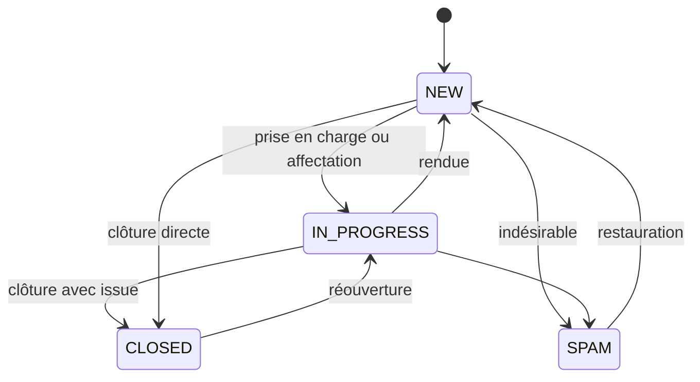
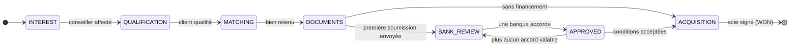
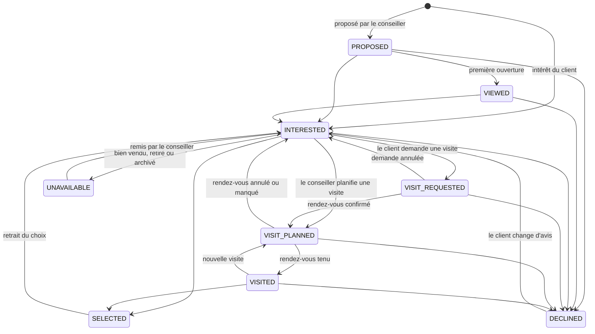
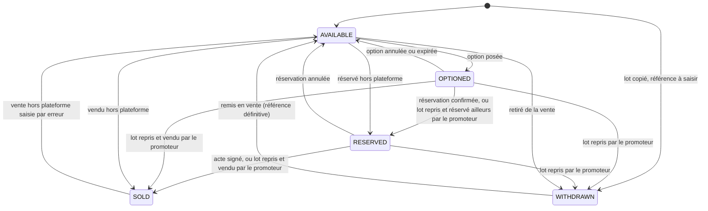
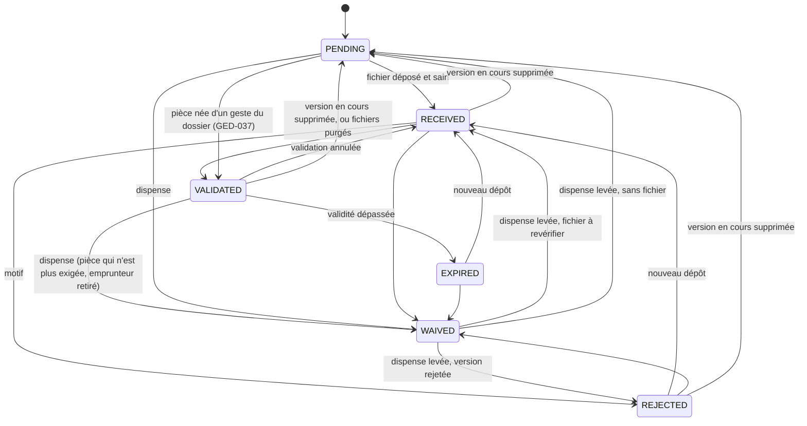
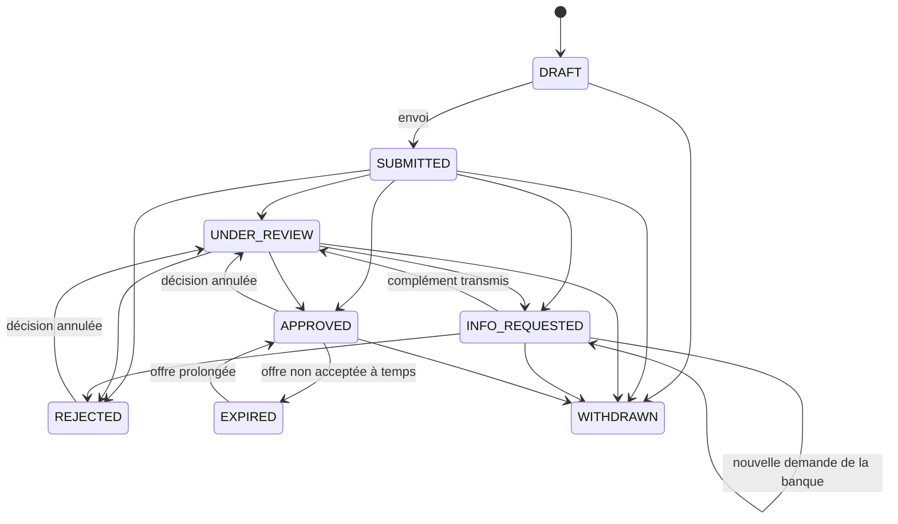

# Cycles de vie

Pour chaque objet qui a un statut : les statuts, les transitions **autorisées**, leurs **conditions** et leurs **effets**. Toute transition absente de ce fichier est **interdite** : l'API la refuse avec `409 CONFLICT_STATE` et un code de raison.

Règles communes :
- une transition et tous ses effets en base se font dans **une seule transaction** ; les effets extérieurs (e-mails, notifications, tâches différées) partent par la boîte d'envoi transactionnelle (`06-technique/04`, FIA-040) ;
- chaque transition est écrite dans le journal d'audit ;
- « automatique » = déclenchée par le système, enregistrée avec `actorType = SYSTEM`.

---

## 1. Demande (`Lead`)

**CYC-001** `[P1]` **Création.** À la réception d'un formulaire, dans une même transaction : (1) la fiche `Client` est retrouvée par son e-mail ou créée (MOD-300) ; (2) la `Lead` est créée à l'état `NEW` ; (3) les consentements sont enregistrés ; (4) selon la nature, un dossier est ouvert ou rejoint (CYC-002) ; (5) l'échéance de premier contact est calculée (CAL-061) ; (6) l'événement `lead.created` est déposé dans la boîte d'envoi. La réponse à l'écran ne part qu'après la validation de cette transaction.

**CYC-002** `[P1]` **Ouverture ou rattachement d'un dossier**, selon la nature de la demande :

| Nature | Ouvre ou rejoint un dossier ? |
|---|---|
| `PROPERTY_INTEREST` | Oui. Le bien devient un bien candidat du dossier (`origin = CLIENT_INTEREST`, statut `INTERESTED`) ; s'il y figure déjà : `PROPOSED`, `VIEWED` ou `DECLINED` → `INTERESTED` (CYC-070) ; tout autre statut est gardé — une visite prévue ou faite, un bien retenu ne reculent pas parce que le client a renvoyé le formulaire. Si la demande ne cite qu'un programme, aucun bien candidat n'est créé : le conseiller proposera les typologies. |
| `PROJECTION_REQUEST` | Oui. |
| `CALLBACK_REQUEST` | Oui. |
| `GUIDED_SEARCH` | Oui (la demande n'existe que si le visiteur a laissé ses coordonnées à la fin du questionnaire). |
| `SIMULATION_FOLLOWUP` | Oui (le visiteur a demandé à être rappelé après une simulation). |
| `CONTACT_MESSAGE` | Non : elle n'ouvre ni ne rejoint un dossier. Le personnel peut en ouvrir un depuis la demande. Envoyée depuis l'espace client (« Écrire à mon conseiller », MSG-021), elle **porte** le dossier d'où elle part (`Lead.contextDossierId` — jamais `dossierId`, qui reste vide) — son conseiller la lit au bon endroit —, sans rien changer à ce dossier, sans émettre `lead.attached` ; elle se traite et se clôt à la main, comme tout message de contact. |
| `PARTNER_REQUEST` | Non. Aucune fiche client. |

Quand la réponse est oui :

| Situation du client | Effet |
|---|---|
| Aucun dossier `OPEN` ni `ON_HOLD` | Un dossier est **créé** à l'étape `INTEREST`, avec `originLeadId`. Conseiller : celui de la demande. Le dossier naît sans conseiller et reçoit celui qui prend la demande en charge (CYC-003) ; une demande affectée d'office — référent disponible, compte unique, répartition (CRM-020) — le lui donne donc aussitôt. Un référent absent au-delà de l'échéance de premier contact ne reçoit ainsi ni la demande ni le dossier (CRM-020). |
| Un dossier `OPEN` à l'étape `INTEREST`, `QUALIFICATION` ou `MATCHING` | La demande **rejoint** ce dossier (le plus récemment actif s'il y en a plusieurs). Elle est affectée au conseiller du dossier, s'il peut la traiter à temps (CRM-020) ; il est notifié. |
| Un dossier `ON_HOLD` aux mêmes étapes | Idem, et une tâche « Le client s'est manifesté : reprendre le dossier ? » est créée. |
| Seulement des dossiers à l'étape `DOCUMENTS` ou au-delà | La demande **n'est pas rattachée**. Elle porte l'indication « Nouvelle demande pendant un dossier en cours ». Le conseiller choisit : « Rattacher au dossier », « Ouvrir un second dossier » ou « Clôturer ». |

**CYC-003** `[P1]` **Prise en charge** (`NEW` → `IN_PROGRESS`). Trois chemins, mêmes effets : le bouton « Prendre en charge » (le conseiller se l'affecte) ; une affectation faite par un administrateur (« Affecter à… ») ; une affectation **d'office** à la création (conseiller du dossier que la demande rejoint, conseiller référent du client, compte unique, répartition : CRM-020). Effets : `assignedAgentId`, `takenAt` ; si la demande a un dossier à l'étape `INTEREST`, ce dossier reçoit le même conseiller et passe à `QUALIFICATION` (CYC-020). Une demande affectée est donc toujours `IN_PROGRESS` : ce qui la protège de l'oubli n'est pas son état, mais son **échéance de premier contact** (CYC-007). Deux conseillers qui cliquent en même temps : le premier l'obtient, le second reçoit « Cette demande vient d'être prise en charge par {prénom}. ».

**CYC-008** `[P1]` **Rendre, réaffecter, rouvrir une demande.**

| Geste | Transition | Conditions | Effets |
|---|---|---|---|
| **Rendre** | `IN_PROGRESS` → `NEW` | Par son conseiller (ou un administrateur), tant que `firstContactAt` est vide. | `assignedAgentId` et `takenAt` vidés ; la demande revient dans « À prendre en charge » et les conseillers sont de nouveau notifiés (`R_LEAD_RELEASED`). Son dossier, s'il est à `QUALIFICATION` sous ce même conseiller et sans premier contact, perd son conseiller et **revient à `INTEREST`** (ligne d'historique système, raison « Demande rendue »). L'échéance de premier contact ne change pas : elle court depuis la création. Si ce conseiller n'était le référent du client que par cette prise en charge — il ne suit pour lui ni autre demande ni dossier —, le référent du client est vidé : la prochaine demande ne lui reviendra pas d'office. |
| **Réaffecter** | `IN_PROGRESS` → `IN_PROGRESS` | `lead.assign`. | Nouveau conseiller, notifié. Son dossier le suit s'il est à `INTEREST` ou `QUALIFICATION` (CYC-040) ; au-delà, le conseiller du dossier se change sur le dossier. |
| **Rouvrir** | `CLOSED` → `IN_PROGRESS` | `lead.process`. Demande clôturée à la main, depuis moins de 90 jours. Une demande rattachée à un dossier ne se rouvre pas : la suite se traite dans le dossier. | Issue et date de clôture vidées ; la demande est affectée à qui la rouvre si elle n'a plus de conseiller actif. L'échéance de premier contact n'est pas recalculée. |

**CYC-009** `[P1]` **Demande d'une personne qui ne voulait plus être contactée.** Envoyer soi-même une demande, case de consentement cochée, vaut accord pour être contacté à son sujet.
- Fiche marquée « Ne pas contacter » (`doNotContact`) : l'opposition est **levée** par cet envoi ; la fiche le note (« Opposition levée par la demande {référence} du {date} »), le journal d'audit aussi ; l'accusé de réception part ; le conseiller est prévenu.
- Fiche dont le traitement est **limité** (`restrictedAt`, ADM-063) : la demande est enregistrée et l'accusé part, mais la limitation n'est pas levée d'office. La demande porte le bandeau « Traitement limité : à confirmer avec la personne », aucune automatisation ne court sur elle, et une tâche prioritaire demande à un administrateur de la joindre pour lever la limitation ou la maintenir.
- Fiche archivée : elle est désarchivée (CYC-061).

**CYC-004** `[P1]` **Premier contact.** `firstContactAt` est renseigné, sur la demande et sur son dossier, au **plus ancien** de ces faits postérieurs à la demande (pour un dossier ouvert à la main : postérieurs à sa création). La liste est fermée :

| Fait | Précision |
|---|---|
| Appel noté avec l'issue `REACHED` | Entrant ou sortant (CRM-030). |
| Échange WhatsApp ou rencontre noté | CRM-031. |
| E-mail **manuel** envoyé au client | Compte à son envoi réel (un envoi programmé compte à l'heure d'envoi). Un e-mail rejeté (`BOUNCED`, `FAILED`) ne compte pas. |
| Message envoyé par le personnel dans la messagerie | |
| Rendez-vous marqué `DONE` | |
| Projection envoyée | BNK-081. |
| Demande saisie par l'équipe avec « Échange déjà eu avec le client » | CRM-025 : le premier contact est la création. |

Un fait noté depuis la **fiche du client**, sans demande désignée (appel, échange, e-mail manuel), vaut premier contact pour **toutes** ses demandes `NEW` ou `IN_PROGRESS` antérieures au fait, et pour leurs dossiers ; `Communication.leadId` reste vide, `clientId` est renseigné.

Les e-mails automatiques ne comptent pas. Si le fait qui valait premier contact est corrigé ou invalidé (issue d'appel corrigée, échange supprimé, e-mail finalement rejeté), `firstContactAt` est **recalculé** d'après les faits restants et peut redevenir vide ; le dossier ne peut alors plus être qualifié tant qu'un vrai contact n'est pas noté (CYC-021). Une demande déjà clôturée d'office par ce premier contact reste clôturée.

**CYC-005** `[P1]` **Clôture** (→ `CLOSED`). Une issue (`LeadOutcome`) est obligatoire.
- Une demande qui a **ouvert ou rejoint** un dossier (CYC-002) se clôt **automatiquement** au premier contact, avec l'issue `DOSSIER_OPENED` (si elle a ouvert le dossier) ou `ATTACHED_TO_DOSSIER`.
- Les autres se clôturent à la main.
- Clôturer avec `UNREACHABLE` ou `NOT_INTERESTED` une demande qui a ouvert un dossier propose, dans la même fenêtre, de clôturer ce dossier comme perdu (CYC-035), motif `UNREACHABLE` ou `CLIENT_WITHDREW`.
- Quand un dossier est clôturé, ou que la personne fait effacer ses données, ses demandes encore ouvertes sont clôturées d'office (CYC-035, effet 6) : aucune relance ne court sur une demande sans suite possible. Un dossier **supprimé** parce qu'ouvert par erreur ne clôt rien : ses demandes redeviennent non rattachées et gardent leur échéance (CYC-038).

**CYC-006** `[P1]` **Indésirable** (→ `SPAM`). Effets : la demande sort de toutes les listes sauf le filtre « Indésirables » ; si la fiche client a été créée par cette demande et n'a rien d'autre, elle est supprimée logiquement ; si un dossier a été ouvert par cette demande et n'a reçu aucune action, il est supprimé logiquement ; aucun e-mail automatique ne part plus vers cette adresse pour cette demande. **« Restaurer »** est possible tant que la demande existe, soit `retention.spamDays` jours (90) :
- dans les `retention.trashDays` premiers jours (30), la fiche et le dossier supprimés sont rétablis tels quels ;
- au-delà, ils ont été purgés : la restauration exécute les étapes 1, 3, 4 et 5 de CYC-001, comme pour une demande qui vient d'arriver.

Une demande classée indésirable **dès sa création** (champ piège, DEM-031) n'a créé ni fiche ni dossier : la restaurer exécute de même les étapes 1, 3, 4 et 5 de CYC-001. Dans tous les cas, l'échéance de premier contact repart de la restauration, et l'accusé de réception n'est envoyé que si la demande a moins de 48 heures ; plus tard, c'est le conseiller qui écrit.

**CYC-007** `[P1]` **Dépassement du délai.** Une tâche planifiée marque `slaBreachedAt` sur les demandes `NEW` ou `IN_PROGRESS` dont `slaDueAt` est passé sans premier contact, et déclenche `lead.sla_breached` (AUT-040).

---

## 2. Dossier

### 2.1 Vue d'ensemble

À chaque étape, tant que le dossier est `OPEN` ou `ON_HOLD` : mise en pause, reprise, clôture (perdu). Un administrateur peut faire reculer d'une étape.

### 2.2 Avancées

| Règle | Transition | Déclencheur | Conditions | Effets |
|---|---|---|---|---|
| **CYC-020** | `INTEREST` → `QUALIFICATION` | Prise en charge d'une demande du dossier, ou affectation d'un conseiller. Automatique s'il n'existe qu'un seul compte actif parmi `OWNER`, `ADMIN` et `AGENT` (CRM-020). | `assignedAgentId` renseigné. | Échéance de l'étape calculée. Demandes du dossier → `IN_PROGRESS`. Le client devient suivi par ce conseiller (`Client.assignedAgentId`, s'il était vide). |
| **CYC-021** | `QUALIFICATION` → `MATCHING` | Bouton « Marquer comme qualifié ». | (a) `firstContactAt` renseigné. (b) Fiche client : prénom, nom, pays de résidence, situation de résidence, budget (total **ou** mensuel), apport (0 accepté), mode de financement souhaité, horizon d'achat (Q-037). (c) `doNotContact` faux. | `Client.qualifiedAt`, `qualifiedById`. `Dossier.qualifiedAt`. Score recalculé (CAL-070). Notification au client (`NC_PROJECT_QUALIFIED`) : « Nous avons fait le point sur votre projet. {conseiller} va vous proposer des biens. » |
| **CYC-022** | `MATCHING` → `DOCUMENTS` | Bouton « Constituer le dossier », proposé dès qu'un bien candidat passe `SELECTED`. | (a) Exactement un bien candidat `SELECTED`. (b) Ce bien est publié, avec une disponibilité `AVAILABLE` ou `RESERVED` au profit de ce dossier. (c) Une liste de pièces s'applique (MOD-340). (d) La situation professionnelle et la situation de résidence du client sont connues : elles décident de sa liste ; la fenêtre permet de les saisir sur place. | `propertyId`, `programId`, `promoterId`, `propertyCountryCode` renseignés. Liste de pièces créée (GED-020). Si le client n'a pas de compte : compte créé à l'état `INVITED` et lien d'activation joint (client sans adresse e-mail : MOD-302). E-mail `C_DOC_REQUEST`. Enquête « après proposition » si elle n'est pas déjà partie. |
| **CYC-023** | `DOCUMENTS` → `BANK_REVIEW` | **Automatique**, quand une soumission du dossier passe `SUBMITTED` (CYC-161). | Celles de CYC-161. | E-mail `C_BANK_SUBMITTED`. |
| **CYC-024** | `DOCUMENTS` → `ACQUISITION` | Bouton « Passer à l'acquisition », visible seulement si `financingRequested` est faux. | Dossier complet (CAL-055). `lotId` renseigné. Réservation du lot à l'état `RESERVED`, si `acquisition.requireReservation` est vrai (défaut) — la même condition qu'en CYC-026. | `conditionsAcceptedAt` = maintenant. Notification au client. |
| **CYC-025** | `BANK_REVIEW` → `APPROVED` | **Automatique**, à la **publication** de l'accord d'une soumission (CYC-164, CYC-165). | — | E-mail `C_BANK_APPROVED`. Enquête « décision bancaire ». Tâche « Présenter l'offre au client » (échéance : 2 jours ouvrés). |
| **CYC-026** | `APPROVED` → `ACQUISITION` | Bouton « Conditions acceptées ». | (a) Une soumission `APPROVED` est désignée comme acceptée (`acceptedSubmissionId`), son offre n'est pas expirée. (b) `lotId` renseigné. (c) Réservation du lot à l'état `RESERVED`, si `acquisition.requireReservation` est vrai (défaut). | `conditionsAcceptedAt`. Les autres soumissions non terminées passent `WITHDRAWN` après confirmation (« 2 autres soumissions seront retirées : … »). Notification au client. |
| **CYC-027** | `ACQUISITION` → état `WON` | Bouton « Acte signé : clôturer le dossier ». | (a) `deedSignedAt` renseignée et non future. (b) `saleAmount` et `saleCurrency` renseignés. (c) `lotId` renseigné, et ce lot est réservé **pour ce dossier** (`RESERVED`) — ou, sans réservation quand `acquisition.requireReservation` est faux, encore `AVAILABLE`. Si la réservation a été annulée entre-temps, il faut d'abord rechoisir et réserver un lot. | `status = WON`, `wonAt`. Réservation → `COMPLETED`. Lot → `SOLD`. Tâches ouvertes du dossier annulées (« Dossier abouti »). Relances arrêtées. E-mail `C_ACQUISITION_DONE`. Enquête « après acquisition » à J+7. Tâche « Demander un témoignage » à J+30. |

**CYC-028** `[P1]` **Perte de l'accord.** Si la dernière soumission `APPROVED` d'un dossier à l'étape `APPROVED` passe `EXPIRED`, est refusée par le client ou est retirée, le dossier **retourne automatiquement** à `BANK_REVIEW` (ligne d'historique `isBackward`, auteur système, raison « Plus aucun accord valable »). S'il ne reste aucune soumission en cours, la tâche de CYC-029 est créée.

**CYC-029** `[P1]` **Toutes les banques ont refusé.** Quand la dernière soumission non terminée d'un dossier en `BANK_REVIEW` passe `REJECTED` (à la publication du refus, CYC-165) ou `WITHDRAWN` et qu'aucune n'est `APPROVED` : le dossier reste en `BANK_REVIEW` ; une tâche prioritaire « Décider de la suite : autre banque, achat sans financement ou clôture » est créée pour le conseiller (D-014) ; la fiche du dossier affiche un bandeau « Aucune soumission en cours ».

**CYC-030** `[P1]` **Avancée par glisser-déposer.** Dans le pipeline, déposer une carte dans la colonne suivante tente la transition. Si une condition manque, rien ne bouge et une fenêtre liste ce qui manque — une ligne par condition, avec son libellé (API-102) —, chaque ligne menant au bon endroit (« Un bien retenu, et un seul → Ouvrir les biens du dossier »). On ne peut pas sauter une étape. Les transitions automatiques (CYC-023, CYC-025) ne se font pas à la main : la colonne refuse le dépôt avec « Cette étape se déclenche à l'envoi d'une soumission. ».

### 2.3 Pause, reprise

**CYC-031** `[P1]` **Mise en pause** (`OPEN` → `ON_HOLD`), à toute étape. Motif (`HoldReason`) obligatoire, note et date de reprise facultatives. Effets : le temps restant avant l'échéance de l'étape est mémorisé (`slaPausedRemainingMinutes`) et `slaDueAt` est vidé ; les relances automatiques vers le client s'arrêtent — pas les rappels d'une échéance qui court malgré la pause (option, offre, rendez-vous : AUT-007) ; les tâches existantes restent ; le client voit « Votre projet est en pause » avec, si le motif est `CLIENT_REQUEST`, la date de reprise. Une case « Informer le client par e-mail » envoie `C_DOSSIER_ON_HOLD` : décochée par défaut, **cochée d'office** quand le motif est `WAITING_CLIENT` — on ne met pas quelqu'un en attente de lui-même sans le lui dire. Pour ce motif, la fenêtre propose aussi le champ « Ce que nous attendons du client (il le lira) », facultatif, 300 caractères (`Dossier.holdClientNote`) : il complète l'e-mail et s'affiche sous le bandeau de pause de l'espace (ECL-022) ; il est vidé à la reprise. La fenêtre de mise en pause **liste ce qui continue de courir** (« Option sur le lot B-304 jusqu'au 14/10 » · « Offre de {banque} valable jusqu'au 30/10 » · « Rendez-vous le 12/10 ») pour que le conseiller décide en connaissance de cause.

**CYC-032** `[P1]` **Reprise** (`ON_HOLD` → `OPEN`), à la main. Effets : nouvelle échéance = `ajouterMinutesOuvrées(maintenant, slaPausedRemainingMinutes)` — un temps restant négatif donne une échéance déjà passée (CAL-060) ; les relances reprennent **depuis le début** — le calendrier des relances de chaque pièce attendue repart du jour de la reprise et son compteur revient à zéro (`reminderBaseAt`, AUT-042) : un client qui revient n'est pas relancé trois fois en une semaine ; les pièces `PENDING` ou `REJECTED` dont l'échéance est passée reçoivent l'échéance aujourd'hui + `documents.defaultDueDays` jours ; à l'étape `DOCUMENTS`, les pièces dont la validité s'est achevée pendant la pause expirent à la nuit suivante (CYC-145), en un seul e-mail ; le client reçoit la notification « Votre projet reprend. ».

**CYC-033** `[P1]` À la date de reprise prévue (`holdUntil`), le dossier **n'est pas repris automatiquement** : une tâche « Reprendre le dossier {référence} » est créée pour le conseiller à 9 h, et la fiche affiche « Reprise prévue aujourd'hui ».

**CYC-034** `[P1]` **Ce qui bouge pendant une pause.**
- Les avancées **à la main** (CYC-021, CYC-022, CYC-024, CYC-026, CYC-027) sont refusées : « Reprenez d'abord le dossier. » (`DOSSIER_ON_HOLD`). Le passage avec ou sans financement (CYC-041) l'est aussi. Restent possibles : clôturer, changer de conseiller, modifier le plan de financement, réévaluer la liste de pièces, gérer les emprunteurs.
- Les transitions **automatiques** se font : une soumission envoyée, accordée, refusée ou expirée produit ses effets (CYC-023, CYC-025, CYC-028, CYC-029), et le dossier change d'étape **en restant en pause**. `slaPausedRemainingMinutes` prend alors le délai entier de la nouvelle étape. Le conseiller reçoit une tâche « Du nouveau sur un dossier en pause ({ce qui s'est passé}) : reprendre le dossier ? » (`R_HOLD_ACTIVITY`).
- Les e-mails de **décision** au client partent (accord, refus, complément demandé : il doit le savoir) ; les **relances** restent suspendues.
- Déposer une pièce, écrire un message, répondre à une proposition restent possibles pour le client ; une action du client sur un dossier en pause crée la même tâche (`R_HOLD_ACTIVITY`) ; une nouvelle demande qui rejoint le dossier, « Le client s'est manifesté : reprendre le dossier ? » (`R_CLIENT_RESURFACED`) — une seule tâche ouverte à la fois, quel que soit le nombre de faits. Un message écrit par le formulaire de l'espace (MSG-021) ne la crée pas : la demande qu'il ouvre, avec son échéance, en tient lieu.

### 2.4 Clôture, réouverture, recul

**CYC-035** `[P1]` **Clôture comme perdu** (→ `LOST`), à toute étape, depuis `OPEN` ou `ON_HOLD`. Motif (`LostReason`) obligatoire ; note obligatoire si le motif est `OTHER`. La fenêtre de clôture **annonce** les effets et demande une confirmation :
1. option ou réservation active → annulée (motif « Dossier clôturé »), le lot redevient `AVAILABLE` ; si elle portait un acompte, son remboursement est à suivre (CYC-108) ;
2. soumissions non terminées → `WITHDRAWN` (CYC-168), l'offre acceptée comprise : `acceptedSubmissionId`, `conditionsAcceptedAt` et `signingScheduledFor` sont vidés — ils décrivaient un accord et une signature qui n'auront pas lieu ; les pièces qu'elles seules demandaient sont dispensées (CYC-170) ;
3. tâches ouvertes du dossier → annulées, sauf celles nées de la clôture (suivi d'un acompte) ;
4. relances → arrêtées ; rendez-vous à venir → annulés. Le client en est prévenu par `C_APPOINTMENT_CANCELLED` dans sa version « sans nouveau créneau » (NOT-060), sauf si le rendez-vous avait été créé sans l'informer (CYC-080). La fenêtre le dit avant de confirmer : « {n} rendez-vous à venir sera annulé ; {client} en sera prévenu par un e-mail qui mentionne la clôture. » — pour ne rien envoyer, on annule d'abord le rendez-vous sans informer le client ;
5. `lostAt` renseigné ; statut du client recalculé (CYC-060) ;
6. les demandes encore ouvertes (`NEW`, `IN_PROGRESS`) rattachées au dossier sont **clôturées** avec l'issue qui répond au motif : `UNREACHABLE` → `UNREACHABLE` ; `DUPLICATE` → `DUPLICATE` ; `CLIENT_WITHDREW`, `BOUGHT_ELSEWHERE` → `NOT_INTERESTED` ; tout autre motif → `ANSWERED`.

Une case « Informer le client par e-mail » (cochée par défaut, sauf pour `DUPLICATE` et `CLIENT_WITHDREW`, où le client sait déjà) envoie `C_DOSSIER_CLOSED`. Le motif interne n'est jamais montré au client.

**CYC-036** `[P1]` **Réouverture** (`LOST` → `OPEN`), permission `dossier.reopen`, raison obligatoire. Rien n'est rétabli automatiquement : ni réservation, ni soumission, ni offre acceptée, ni tâche. Le dossier rouvre donc à l'étape **la plus avancée dont les conditions tiennent encore**, sans dépasser celle où il se trouvait :

| Étape de réouverture | Il faut |
|---|---|
| `DOCUMENTS` | Le bien retenu est encore publié et disponible (CYC-022, condition b). C'est le plafond d'un dossier qui avait atteint `DOCUMENTS` ou au-delà : la clôture a retiré les soumissions et annulé la réservation. |
| `MATCHING` | Le client est qualifié (`qualifiedAt`). Le bien retenu qui n'est plus disponible passe `UNAVAILABLE`. |
| `QUALIFICATION` | Un conseiller actif est affecté. |
| `INTEREST` | Sinon. |

L'échéance de l'étape repart entière. La ligne d'historique de la réouverture (`LOST` → `OPEN`) porte `isBackward` vrai si l'étape de réouverture est antérieure à celle de la clôture. Les pièces dont les fichiers ont été purgés depuis la clôture (SEC-110) repassent `PENDING` et la complétude est recalculée. Le calendrier des relances de pièces repart du jour de la réouverture, comme après une pause (CYC-032). Le client reçoit la notification « Votre projet reprend. » (`NC_DOSSIER_RESUMED`), et son tableau de bord la ligne « Votre dossier est rouvert. » (ECL-031). Un dossier `WON` ne se rouvre pas.

**CYC-037** `[P1]` **Recul d'une étape**, permission `dossier.transition.backward`, raison obligatoire, dossier `OPEN`. L'étape visée est celle du tableau ci-dessous — pour `ACQUISITION`, elle dépend de `financingRequested` (vrai : `APPROVED` ; faux : `DOCUMENTS`) ; le journal des étapes n'est pas consulté :

| De | Vers | Conditions | Effets propres |
|---|---|---|---|
| `QUALIFICATION` | `INTEREST` | — | Conseiller retiré du dossier — et du client, s'il n'était son référent que par ce dossier (CYC-008). |
| `MATCHING` | `QUALIFICATION` | — | `qualifiedAt` du dossier vidé ; la fiche du client garde sa qualification. |
| `DOCUMENTS` | `MATCHING` | Aucune soumission non terminée, brouillons compris (sinon `SUBMISSION_IN_PROGRESS`) ; aucune réservation `RESERVED` (sinon `RESERVATION_ACTIVE`). | Le bien retenu reste retenu. |
| `BANK_REVIEW` | `DOCUMENTS` | Aucune soumission non terminée : il faut d'abord les retirer (`SUBMISSION_IN_PROGRESS`). | — |
| `APPROVED` | `BANK_REVIEW` | **Jamais à la main.** Ce retour est automatique, quand il ne reste aucun accord valable (CYC-028) : pour l'obtenir, on retire ou on corrige l'accord (CYC-169). | — |
| `ACQUISITION` | `APPROVED` (avec financement) | L'offre acceptée est encore `APPROVED` et non expirée. | `conditionsAcceptedAt` vidé. |
| `ACQUISITION` | `DOCUMENTS` (sans financement) | — | `conditionsAcceptedAt` vidé. |

Aucun recul depuis un dossier `WON` ou `LOST`. Un recul fait `stageEnteredAt` = maintenant, et l'échéance de l'étape visée repart entière (CAL-062). Un recul n'envoie **aucun** e-mail au client et ne supprime rien (les pièces restent). Il est marqué dans l'historique (`isBackward`). Quand le dossier **avance de nouveau**, les conditions de la transition sont rejouées, mais ses effets déjà produits ne le sont pas : la liste de pièces n'est pas recréée, elle est réévaluée (GED-031) ; les e-mails et les enquêtes de première entrée dans l'étape ne repartent pas.

**CYC-038** `[P1]` **Suppression** d'un dossier ouvert par erreur : conditions de MOD-312, permission `dossier.delete`, suppression logique, restaurable pendant `retention.trashDays` jours. Les demandes qui y étaient rattachées redeviennent non rattachées.

**CYC-041** `[P1]` **Avec ou sans financement.** À l'ouverture d'un dossier, `financingRequested` est **faux** si la demande ou la fiche du client indique « Sans financement » (`FinancingPreference.CASH`), vrai sinon ; `Dossier.financingType` reprend la préférence. Le conseiller peut ensuite changer (onglet Emprunteurs, PIP-055) :

| Changement | Possible | Effets |
|---|---|---|
| Vers **sans financement** | À `INTEREST`, `QUALIFICATION`, `MATCHING`, `DOCUMENTS` ; à `BANK_REVIEW` ou `APPROVED` seulement s'il ne reste aucune soumission **envoyée** non terminée (la fenêtre propose de les retirer d'abord). À toute étape, les **brouillons** de soumission sont retirés par le changement lui-même. | `financingRequested` faux, `financingType = CASH`. Un dossier à `BANK_REVIEW` ou `APPROVED` **revient à `DOCUMENTS`** (ligne d'historique système, raison « Achat sans financement »). La liste de pièces est réévaluée (GED-031) : les pièces propres au financement sont dispensées, qu'elles aient un fichier ou non — un acheteur comptant n'est pas relancé pour un bulletin de salaire. Il en va de même de ce qu'une banque avait demandé : pièces de sa liste, compléments. Un garant, qui n'a de sens qu'avec un financement, est retiré du dossier (MOD-321) ; un co-emprunteur y reste, comme **co-acquéreur**. Le client lit dans son suivi « Votre projet se poursuit sans financement bancaire. » (ECL-031) ; aucun e-mail ne part : c'est avec son conseiller qu'il en a convenu. La suite passe par CYC-024. |
| Vers **avec financement** | À `INTEREST`, `QUALIFICATION`, `MATCHING`, `DOCUMENTS`. À `ACQUISITION` : reculer d'abord (CYC-037). | `financingRequested` vrai ; la fenêtre demande le type souhaité — `CONVENTIONAL`, `ISLAMIC` ou `NO_PREFERENCE`, prérempli avec la préférence de la fiche du client si elle n'est pas `CASH`, sinon `NO_PREFERENCE` —, qui devient `financingType` ; liste de pièces réévaluée (les pièces de financement sont créées). |

C'est le chemin d'une famille qui paie comptant après des refus bancaires (CYC-029). Correspondance des valeurs : `CONVENTIONAL` et `ISLAMIC` filtrent les produits du même type ; `NO_PREFERENCE` ne filtre pas les produits ; `CASH` vaut « sans financement ». Pour les modèles et les lignes de pièces : MOD-340. Dans les deux sens, le libellé des pièces dont la ligne a un libellé de remplacement (`labelWhenCash`) est recalculé — ce libellé sans financement, le libellé ordinaire sinon —, sauf s'il a été modifié à la main (`labelEdited`).

### 2.5 Inactivité, changement de conseiller

**CYC-039** `[P1]` Un dossier `OPEN` sans activité depuis `dossier.inactivityDays` jours (30) reçoit l'indication « Inactif » et une tâche « Relancer ou clôturer » (une seule à la fois, `dedupeKey`). Aucun dossier n'est clôturé automatiquement.

**CYC-040** `[P1]` **Changement de conseiller.** Effets : passent de l'ancien conseiller au nouveau les **tâches ouvertes** du dossier, ses **rendez-vous à venir** (`staffUserId`) et ses **demandes ouvertes** — celles qui ont ouvert ou rejoint le dossier, et les messages écrits depuis lui (`Lead.contextDossierId`) — ; le fil de messagerie continue ; l'ancien et le nouveau sont notifiés ; le client reçoit `C_ADVISOR_CHANGED` (« Votre conseiller est désormais {prénom} ») sauf si la case « Ne pas informer le client » est cochée. Si l'ancien conseiller était le **référent** du client (`Client.assignedAgentId`) et que le client n'a plus d'autre dossier ouvert avec lui, le nouveau conseiller devient son référent. Le référent se change aussi seul, depuis la fiche du client (« Changer de conseiller référent », `client.assign`), sans toucher aux dossiers.

---

## 3. Statut du client

**CYC-060** `[P1]` `Client.status` est **calculé** après tout changement d'un dossier, de `qualifiedAt`, de `archivedAt`, et chaque nuit. Première règle vraie, dans cet ordre :

| Ordre | Statut | Condition |
|---|---|---|
| 1 | `ARCHIVED` | `archivedAt` renseigné. |
| 2 | `CUSTOMER` | Au moins un dossier `WON`. |
| 3 | `ACTIVE` | Au moins un dossier `OPEN` ou `ON_HOLD` à l'étape `DOCUMENTS` ou au-delà. |
| 4 | `INACTIVE` | Aucun dossier `OPEN` ni `ON_HOLD`, et `lastActivityAt` plus ancien que `clients.inactiveAfterDays` (180 jours). |
| 5 | `QUALIFIED` | `qualifiedAt` renseigné. |
| 6 | `PROSPECT` | Tous les autres cas. |

**CYC-061** `[P1]` **Archivage** d'un client (permission `client.archive`) : refusé s'il a un dossier `OPEN` ou `ON_HOLD`. Effets : il sort des listes par défaut ; ses alertes sont désactivées ; il ne reçoit plus d'e-mail commercial. Son compte reste utilisable. Une nouvelle demande de sa part le désarchive automatiquement.

---

## 4. Bien candidat (`DossierCandidate`)

Le schéma montre l'essentiel ; le tableau de CYC-070 **fait foi**. En particulier, `UNAVAILABLE` s'atteint depuis presque tous les statuts (CYC-073).

**CYC-070** `[P1]` **Transitions autorisées.**

| Vers | Depuis | Qui | Précisions |
|---|---|---|---|
| `VIEWED` | `PROPOSED` | Automatique | Première ouverture de la proposition par le client (INT-011). |
| `INTERESTED` | `PROPOSED`, `VIEWED` | Le client (« Ce bien m'intéresse ») ; le conseiller en son nom | Répondre depuis la liste, sans ouvrir le détail, marque aussi le bien comme vu (`viewedAt`). Une demande d'intérêt envoyée depuis la fiche du bien vaut ce geste, pour un bien proposé comme pour un bien écarté (CYC-002). |
| `INTERESTED` | `DECLINED` | Le client (« Finalement, il m'intéresse ») ; le conseiller | |
| `INTERESTED` | `VISIT_REQUESTED`, `VISIT_PLANNED` | Automatique | Le rendez-vous lié est annulé, refusé ou marqué `NO_SHOW` (CYC-080). Le client peut alors de nouveau retenir le bien, l'écarter ou reprendre rendez-vous. |
| `INTERESTED` | `SELECTED` | Le conseiller | Retrait du choix, sous conditions (CYC-242). |
| `INTERESTED` | `UNAVAILABLE` | Le conseiller | Le bien est redevenu disponible (CYC-073). |
| `DECLINED` | `PROPOSED`, `VIEWED`, `INTERESTED`, `VISIT_REQUESTED`, `VISIT_PLANNED`, `VISITED` | Le client, avec la raison (INT-021) ; le conseiller | Un rendez-vous à venir pour ce bien est annulé, après confirmation. Un choix en attente (`selectionRequestedAt`) est retiré. |
| `VISIT_REQUESTED` | `INTERESTED`, `VISITED` | Le client `[P1]` (INT-040) | Crée un rendez-vous `REQUESTED`. |
| `VISIT_PLANNED` | `VISIT_REQUESTED` | Automatique | Le rendez-vous demandé est confirmé. |
| `VISIT_PLANNED` | `PROPOSED`, `VIEWED`, `INTERESTED`, `VISITED` | Le conseiller | Il crée un rendez-vous de visite ou de visio pour ce bien (TAC-040) : c'est le chemin normal en Phase 1. |
| `VISITED` | `VISIT_PLANNED` | Automatique | Le rendez-vous lié passe `DONE`. |
| `VISITED` | `PROPOSED`, `VIEWED`, `INTERESTED`, `VISIT_REQUESTED` | Le conseiller | Une visite déjà faite, notée après coup (rendez-vous créé à `DONE`, CYC-080) ; ou une issue corrigée en « tenue ». |
| `INTERESTED` | `VISITED` | Le conseiller (« Corriger l'issue ») | La visite notée « tenue » ne l'était pas : l'issue corrigée en absence ou en annulation rejoue l'effet (CYC-080). |
| `SELECTED` | `INTERESTED`, `VISIT_REQUESTED`, `VISIT_PLANNED`, `VISITED` — et, par le conseiller seulement, `PROPOSED`, `VIEWED` | Le conseiller (CYC-071). Le client **demande** (« Je retiens ce bien », depuis `INTERESTED` ou `VISITED`, INT-030) ; le conseiller confirme. | Un rendez-vous à venir pour ce bien est conservé. |
| `UNAVAILABLE` | Tout statut sauf `DECLINED` ; `SELECTED` seulement sans réservation active | Automatique | CYC-073. |

Les effets d'un rendez-vous sur le statut ne jouent que depuis les statuts de ce tableau : un bien retenu ou écarté entre-temps garde son statut.

**CYC-071** `[P1]` **Retenir un bien** (→ `SELECTED`). Conditions : le bien est publié et il lui reste au moins un lot `AVAILABLE` (ou le lot est déjà sous option pour ce dossier). Effets : `Dossier.propertyId` renseigné ; `Dossier.lotId` : le lot choisi dans la fenêtre — à défaut, quand le conseiller confirme le choix demandé par le client, le lot préféré du client (`DossierCandidate.lotId`) s'il est encore `AVAILABLE` ; les routes `select` et `confirm-selection` portent un `lotId` facultatif — ; `Dossier.purchasePrice` prérempli (MOD-313) ; si un autre candidat était `SELECTED`, il repasse `INTERESTED` (un seul bien retenu) ; le choix en attente du client est soldé (`selectionRequestedAt` vidé) ; le client est prévenu (`NC_SELECTION_CONFIRMED`) ; le bouton « Constituer le dossier » apparaît (CYC-022). **Refuser** le choix demandé par le client (PIP-030) : raison obligatoire, montrée au client ; `selectionRequestedAt` vidé ; notification `NC_SELECTION_DECLINED`.

**CYC-072** `[P1]` **Changer de bien retenu** après le passage à `DOCUMENTS` : permis seulement s'il n'y a ni réservation à l'état `RESERVED`, ni soumission **en cours** déjà envoyée (`SUBMITTED`, `UNDER_REVIEW`, `INFO_REQUESTED`, `APPROVED`) — une soumission refusée, retirée ou expirée ne bloque pas. Effets : les pièces de catégorie `PROPERTY` qui ont un fichier sont **remises à zéro** pour le nouveau bien : chacune garde sa ligne et son code — aucune pièce n'est créée en double (MOD-019) —, sa version en cours rejoint l'historique avec la mention « Bien remplacé », `currentVersion` revient à 0 et le statut à `PENDING` ; une option active est annulée (et son acompte suivi, CYC-108) ; `propertyId`, `lotId`, `purchasePrice` et les champs recopiés sont mis à jour ; les soumissions en préparation sont gardées, avec l'avertissement « Le bien a changé : vérifiez le montant demandé. ».

**CYC-242** `[P1]` **Retirer le choix** (`SELECTED` → `INTERESTED`, route `unselect`, `candidate.manage`) : le dossier n'a plus de bien retenu. Possible avant l'étape `DOCUMENTS` seulement — à partir de là, un bien retenu est obligatoire et l'on en change (CYC-072). Refusé tant qu'une option ou une réservation est active (`409 CONFLICT_STATE`, raison `DOSSIER_HAS_RESERVATION`) : on l'annule d'abord (PIP-050), avec ses propres effets. Raison facultative, interne. Effets, dans la même transaction : `Dossier.propertyId`, `lotId`, `programId`, `promoterId`, `purchasePrice` et `purchaseCurrency` sont vidés ; `propertyCountryCode` revient au premier pays préféré du client ; événement `candidate.unselected` ; le client reçoit la notification `NC_SELECTION_WITHDRAWN`, sans e-mail, lit dans son Suivi « Le choix de {bien} a été retiré. » (ECL-031), et son onglet Mon bien disparaît (ECL-032). « Constituer le dossier » n'est plus proposé (condition `SELECTED_CANDIDATE`, CYC-022).

**CYC-073** `[P1]` **Bien devenu indisponible.** Quand un bien passe à la disponibilité `SOLD` ou `WITHDRAWN`, ou est archivé : ses candidats passent `UNAVAILABLE` (sauf `DECLINED`, et sauf `SELECTED` protégé par une réservation active ou aboutie) — dans les dossiers **ouverts ou en pause** seulement : un dossier gagné ou clôturé garde ses candidats tels qu'ils étaient, et celui qui vient d'acheter un bien ne lit jamais que « son » bien n'est plus disponible ; le conseiller de chaque dossier est notifié (« Le bien {titre} n'est plus disponible ») ; le client voit « Ce bien n'est plus disponible » et trois biens similaires. Un rendez-vous de visite à venir pour ce bien est signalé au conseiller (tâche « Visite prévue sur un bien devenu indisponible : annuler ou maintenir »), jamais annulé d'office.

- Si le candidat était **retenu** (`SELECTED`, sans réservation) : avant l'étape `DOCUMENTS`, le dossier perd son bien retenu, avec les mêmes effets sur ses champs que CYC-242 (sans la notification `NC_SELECTION_WITHDRAWN` : le client lit « Ce bien n'est plus disponible ») ; à partir de `DOCUMENTS`, le dossier garde la référence du bien, affiche le bandeau « Le bien retenu n'est plus disponible », reçoit une tâche prioritaire « Bien retenu indisponible : proposer un autre bien ou clôturer », et aucune soumission ne peut plus être **envoyée** tant qu'un bien disponible n'est pas retenu (CYC-161).
- Une disponibilité `RESERVED` (plus aucun lot libre, mais des options ou des réservations en cours) **ne change pas** le statut des candidats : une option peut expirer. Le client lit « Tous les lots sont réservés pour le moment. {conseiller} vous prévient si l'un d'eux se libère. », et ne peut pas demander à retenir ce bien. Un dossier qui avait **déjà retenu** ce bien sans y tenir de lot le garde retenu, avec la même mention ; l'envoyer à une banque reste possible, après confirmation (CYC-161). Son conseiller en est prévenu (`NS_PROPERTY_RESERVED`) : à lui de poser une option dès qu'un lot se libère, ou de proposer un autre bien.
- Si le bien redevient disponible, rien n'est rétabli automatiquement : le conseiller remet le candidat à `INTERESTED`.

---

## 5. Rendez-vous (`Appointment`)

**CYC-080** `[P1]` Transitions. Les rendez-vous créés par le personnel sont en Phase 1 ; la **demande** par le client (première ligne) est `[P1]`.

| Transition | Qui | Conditions et effets |
|---|---|---|
| création à `REQUESTED` `[P1]` | Client | Jusqu'à trois créneaux souhaités. `clientNotifiedAt` est renseigné dès la demande : le client qui a demandé un rendez-vous en suit toujours la suite par e-mail — confirmation, refus, rappel, annulation. Tâche « Confirmer le rendez-vous » pour le conseiller (échéance : 1 jour ouvré). Pour une visite : le bien passe `VISIT_REQUESTED`. |
| création à `CONFIRMED` | Personnel | Date, heure et conseiller obligatoires. Si « Informer le client » est coché (défaut) : e-mail `C_APPOINTMENT_CONFIRMED` avec fichier d'agenda, et `clientNotifiedAt` est renseigné. Pour une visite : le bien passe `VISIT_PLANNED`. |
| création à `DONE` | Personnel | Rendez-vous passé, noté après coup (TAC-044). Aucun e-mail. Pour une visite : le bien passe `VISITED`. |
| `REQUESTED` → `CONFIRMED` | Personnel | Date, heure et conseiller obligatoires. Le client est toujours informé (c'est lui qui a demandé) : `C_APPOINTMENT_CONFIRMED`, `clientNotifiedAt`. |
| `REQUESTED` → `CANCELLED` (refus) | Personnel | Un mot au client est obligatoire ; il le reçoit dans `C_APPOINTMENT_CANCELLED`. Le bien lié revient à `INTERESTED`. |
| `CONFIRMED` → `CONFIRMED` (report) | Personnel | Nouvelle date ; e-mail `C_APPOINTMENT_CONFIRMED` avec la mention « Nouvelle date », si le client avait été informé du rendez-vous. `reminderSentAt` remis à nul. |
| → `CANCELLED` | Client ou personnel | Jusqu'à l'heure de début. L'autre partie est prévenue : le conseiller par `NS_APPOINTMENT_CANCELLED` ; le client par `C_APPOINTMENT_CANCELLED`, **seulement s'il avait été informé** du rendez-vous (`clientNotifiedAt`) et si « Informer le client » reste coché. Le bien lié revient à `INTERESTED`. |
| `CONFIRMED` → `DONE` | Personnel | Après l'heure de début. Compte rendu facultatif. Compte comme premier contact (CYC-004). Pour une visite : le bien passe `VISITED`. |
| `CONFIRMED` → `NO_SHOW` | Personnel | Après l'heure de début. Tâche « Recontacter le client » (`R_APPOINTMENT_NO_SHOW`). Le bien lié revient à `INTERESTED`. |

Un rappel `C_APPOINTMENT_REMINDER` part 24 heures avant (AUT-051), seulement si le client a été informé du rendez-vous. Dans cette règle, « informer le client » s'entend de l'**e-mail** : le rendez-vous, lui, figure toujours dans son espace, avec sa notification (TAC-040, INT-041). Un rendez-vous `CONFIRMED` dont la fin est passée depuis 2 jours ouvrés sans issue crée une tâche « Renseigner l'issue du rendez-vous ». Un rendez-vous terminé (`DONE`, `NO_SHOW`, `CANCELLED`) ne change plus d'état ; une erreur d'issue se corrige par « Corriger l'issue » (`appointment.manage`, dans les 7 jours, raison obligatoire), qui rejoue les effets sur le bien et sur le premier contact (CYC-004).

---

## 6. Lot et réservation

### 6.1 Lot

**CYC-100** `[P1]` Le statut d'un lot change de deux façons seulement :
- par sa **réservation** (CYC-105) : c'est le cas normal — y compris quand le promoteur reprend un lot qu'un dossier tenait : l'annulation de la réservation le fait alors passer directement à `SOLD`, `RESERVED` (hors plateforme) ou `WITHDRAWN` (CYC-107) ;
- **à la main**, pour une vente ou une réservation faite **hors plateforme** (`externalSale = true`) ou un retrait : `AVAILABLE` → `RESERVED`, `SOLD` ou `WITHDRAWN` ; `WITHDRAWN` → `AVAILABLE` (jamais tant que la référence du lot est provisoire : MOD-230) ; `RESERVED` (externe) → `AVAILABLE` ou `SOLD`. Une note est demandée.

Un lot qui a une réservation active ne peut pas **changer de statut** à la main : il faut passer par la réservation. Ses autres champs restent modifiables — surface, étage, livraison, et son **prix public** : c'est celui qu'il retrouvera s'il revient en vente ; le prix convenu d'une réservation, lui, ne suit jamais le prix public (MOD-313).

**Corriger une vente saisie par erreur.** Un lot marqué « vendu hors plateforme » par erreur revient à `AVAILABLE` : `SOLD` (externe) → `AVAILABLE`, par un administrateur (`catalogue.publish`), raison obligatoire, tracée. Un lot vendu **par un dossier** (réservation `COMPLETED`) ne revient jamais : la vente a eu lieu. Si la fiche avait été archivée entre-temps (CYC-123), elle se désarchive à la main (CYC-121) ; les candidats passés `UNAVAILABLE` ne sont pas rétablis d'office, mais leurs conseillers sont prévenus (CYC-102).

**CYC-101** `[P1]` Tout changement de statut d'un lot recalcule les caches du bien et du programme (MOD-220) et, si le bien change de disponibilité, déclenche CYC-073 et la revalidation des pages publiques.

**CYC-102** `[P1]` **Ce qu'un changement de lot dit aux autres dossiers.**
- **Un lot visé par un dossier lui échappe.** Un dossier peut viser un lot sans l'avoir réservé (`Dossier.lotId` choisi dans l'onglet Bien, en attendant le promoteur). Quand ce lot quitte `AVAILABLE` pour un autre que lui — option d'un collègue, vente ou réservation hors plateforme, retrait — : `lotId` est **vidé** sur ce dossier, son conseiller est notifié (« Le lot {référence} visé par le dossier {référence} vient d'être {réservé / vendu / retiré}. »), l'onglet Bien affiche le bandeau « Le lot visé n'est plus libre : choisissez-en un autre », et le client ne lit plus de numéro de lot dans son suivi (ECL-032). Viser un lot ne protège rien : seule l'option le réserve — la fenêtre de choix du lot le dit (PIP-050). Le lot que le client avait dit préférer en demandant à retenir le bien (`DossierCandidate.lotId`) suit la même règle : il est vidé, et le bandeau du choix à confirmer le dit (PIP-030). Rien de cela ne touche un dossier gagné ou clôturé : son lot reste le sien.
- **Un bien ou un lot se libère.** Quand la disponibilité d'un bien repasse à `AVAILABLE`, ou qu'un de ses lots redevient `AVAILABLE` alors que le bien l'était resté (option expirée, annulée ou refusée par le promoteur, vente corrigée, lot remis en vente), ou qu'une fiche archivée revient en ligne (CYC-126) : le conseiller de chaque dossier **ouvert ou en pause** qui a un candidat vivant sur ce bien (ni `DECLINED`, ni `SELECTED` ailleurs) est notifié — hors le dossier qui tenait ce lot, déjà prévenu par la fin de son option — « {bien} est de nouveau disponible (dossier {référence}). » (`NS_PROPERTY_AVAILABLE`). C'est ce qui tient la promesse faite au client : « {conseiller} vous prévient si l'un d'eux se libère » (CYC-073). Le client n'est pas prévenu d'office : c'est le conseiller qui rappelle.

### 6.2 Réservation

**CYC-105** `[P1]` Transitions :

| Transition | Conditions | Effets |
|---|---|---|
| création à `OPTION` | Lot `AVAILABLE`. Bien publié (sinon raison `PROPERTY_OFFLINE`) ; une option déjà posée n'est pas touchée par une dépublication. Le dossier est `OPEN`, à l'étape `MATCHING` ou au-delà, et a retenu le bien du lot. Aucune réservation active pour le dossier (MOD-331) ni pour le lot (MOD-330). | Lot → `OPTIONED`. `Dossier.lotId` renseigné. `optionExpiresAt` calculé. `agreedPrice` et `Dossier.purchasePrice` alignés (MOD-313). Le client est prévenu — « Une option est posée sur le lot {référence} jusqu'au {date}. » — **quand le promoteur a confirmé qu'il tient le lot** : tout de suite si c'est déjà le cas à la pose, sinon à sa confirmation (CYC-107). |
| prolongation de l'option | État `OPTION`, moins de `reservation.maxExtensions` prolongations (au-delà : `reservation.override`). La nouvelle date est future. Le promoteur a donné son accord pour tenir le lot jusqu'à cette date (CYC-107). | Nouvelle date. `optionExtendedCount` + 1. `optionAcknowledgedAt` et `optionAcknowledgedBy` mis à jour. Le rappel d'expiration est réarmé. Le client lit la nouvelle date dans son espace. Prolonger une option qui n'avait pas encore été confirmée vaut confirmation : `reservation.option_acknowledged` est émis, et le client est prévenu comme à toute confirmation (CYC-107). |
| `OPTION` → `RESERVED` | Date de confirmation du promoteur renseignée. | `reservedAt`. Lot → `RESERVED`. E-mail `C_RESERVATION_CONFIRMED`. L'acompte, s'il est saisi, porte sa devise et son justificatif (GED-037). |
| `OPTION` → `EXPIRED` | **Automatique** à `optionExpiresAt`. | Lot → `AVAILABLE`. `Dossier.lotId` vidé. Notification au conseiller ; au client aussi si le promoteur avait confirmé l'option (CYC-107). Un rappel part 2 jours avant : tâche pour le conseiller, et `C_OPTION_EXPIRING` au client dans le même cas. |
| `OPTION` ou `RESERVED` → `CANCELLED` | Motif obligatoire. | Lot → `AVAILABLE` — ou, quand c'est **le promoteur qui a repris le lot**, l'état que dit le conseiller (vendu, réservé ailleurs, retiré : CYC-100, avec `externalSale`), pour qu'il ne repasse pas en vente entre deux saisies ; dans ce cas, pas de tâche de prévenir le promoteur. `Dossier.lotId` vidé. Notification au client si la case « Informer le client » est cochée — elle n'est proposée que si le client avait été prévenu de l'option ou de la réservation (CYC-107). Acompte : CYC-108. Si le dossier est à l'étape `ACQUISITION`, il y reste, avec le bandeau « Plus de lot réservé » et la tâche prioritaire « Réservation annulée en cours d'acquisition : réserver un autre lot ou clôturer » ; l'acte ne peut pas être enregistré sans lot réservé (CYC-027). |
| `RESERVED` → `COMPLETED` | **Automatique**, quand le dossier est gagné (CYC-027). | Lot → `SOLD`. |

Compléter après coup une réservation `RESERVED` (acompte, contrat signé, date de livraison au contrat) est toujours possible tant que le dossier n'est pas terminé (PIP-050).

**Dossier en pause ou terminé.** Sur un dossier `ON_HOLD`, prolonger l'option, enregistrer la réponse du promoteur, confirmer la réservation, l'annuler et la compléter après coup sont permis — une option court malgré la pause — ; poser une option ou réserver directement est refusé (raison `DOSSIER_ON_HOLD`). Sur un dossier `WON` ou `LOST`, seule l'issue de l'acompte s'enregistre (CYC-108) ; tout autre geste de réservation répond `TRANSITION_NOT_ALLOWED`.

**Échéance d'une option.** Les dates d'une option — échéance à la pose, nouvelle date d'une prolongation, date donnée par le promoteur (CYC-107) — se saisissent sans heure ; chacune vaut 23 h 59 min 59 s dans le fuseau du pays du bien (`Country.timezone`), où le promoteur tient le lot, et c'est à cet instant que l'option expire. Elle est montrée partout comme cette date, sans heure ni conversion de fuseau, au client comme à l'équipe : exception à TRV-031 et TRV-032.

**CYC-106** `[P1]` Création directe à l'état `RESERVED` (réservation déjà signée quand le conseiller la saisit) : autorisée, mêmes conditions que la pose d'une option (CYC-105). La fenêtre « Réserver directement » (PIP-050) demande le lot, le prix convenu et les champs de « Confirmer la réservation », dont la date de confirmation du promoteur, obligatoire. Effets : la réservation naît `RESERVED` (`reservedAt`, `promoterConfirmedAt`, `promoterConfirmedBy`), avec `optionAcknowledgedAt` = `promoterConfirmedAt` et `optionAcknowledgedBy` = `promoterConfirmedBy` ; lot → `RESERVED` ; `Dossier.lotId` et le prix comme à la pose d'une option (MOD-313). Seul `reservation.confirmed` est émis — d'où `C_RESERVATION_CONFIRMED` et `R_RESERVATION_CONTRACT` — : ni `reservation.option_placed`, ni tâche de confirmation de l'option, ni rappel d'échéance.

**CYC-107** `[P1]` **Le promoteur tient-il le lot ?** Une option posée sur la plateforme ne protège le client que si le promoteur **sait** qu'il doit tenir le lot, et jusqu'à quand. La réservation garde donc sa réponse (`optionAcknowledgedAt`, `optionAcknowledgedBy`) : c'est le geste `OPTION_ANSWER` (ACP-020), saisi par l'équipe en Phase 1, à la pose de l'option (PIP-050 ; `[P2]` PIP-053).

| Moment | Ce qui se passe |
|---|---|
| À la pose | Le conseiller dit si le promoteur tient déjà le lot. **Oui** : la marque est posée, le client est prévenu (une seule notification pour `reservation.option_placed` et `reservation.option_acknowledged`). **Pas encore** : l'option court sur la plateforme — aucun collègue ne peut prendre le lot —, et une tâche demande au conseiller de la faire confirmer (`R_OPTION_UNCONFIRMED`, un jour ouvré). |
| Le promoteur confirme | Il tient le lot **jusqu'à une date** : par défaut l'échéance de l'option ; s'il en donne une autre, l'échéance prend cette date. Cette date est future (sinon `DATE_NOT_FUTURE`). Plus proche que l'échéance : l'échéance l'adopte. Plus lointaine : c'est aussi une **prolongation**, soumise à `reservation.maxExtensions` (au-delà, `reservation.override`), qui incrémente `optionExtendedCount` et émet aussi `reservation.option_extended`. La marque est posée, avec le nom de son interlocuteur (`reservation.option_acknowledged`) ; la tâche se termine ; le client est prévenu. S'il reste moins de deux jours avant l'échéance, la fenêtre le dit au conseiller : « L'option se termine le {date} : demandez au promoteur de la prolonger. » |
| Prolonger | Prolonger une option, c'est redemander au promoteur de tenir le lot : la prolongation ne s'enregistre qu'avec son accord (son interlocuteur est obligatoire). La marque et l'échéance sont mises à jour ensemble ; le client lit la nouvelle date. |
| Le promoteur refuse | L'option est annulée (`OPTION` → `CANCELLED`, motif « Refusée par le promoteur : {raison} » ; événements `reservation.option_refused` et `reservation.cancelled`, sans notification au client). Le lot prend l'état que dit le promoteur : libre de nouveau, ou vendu, réservé ailleurs, retiré (CYC-100, avec `externalSale` s'il y a lieu) — c'est un effet de la commande de réservation, sous `reservation.manage`. Si ce nouvel état rend le **bien** indisponible — dernier lot vendu ou retiré —, la règle générale s'applique : le client lit « Ce bien n'est plus disponible » (CYC-073), et la fenêtre l'annonce avant d'enregistrer. Dans tous les cas, une tâche demande au conseiller du dossier d'appeler le client (`R_OPTION_REFUSED`). |
| Sans réponse | L'option expire à son échéance, comme une autre. Le conseiller reçoit ses rappels et, à l'expiration, la tâche d'appeler le client (`R_OPTION_UNCONFIRMED_ENDED`). |
| La réservation est confirmée directement | `OPTION` → `RESERVED` vaut confirmation de l'option : la marque est posée, sans événement `reservation.option_acknowledged` — le client reçoit « Votre réservation est confirmée », pas « une option est posée ». Une réservation créée directement (CYC-106) naît confirmée. |

**Ce que lit le client**, selon que le promoteur a confirmé ou non :

| Où | Option non confirmée | Option confirmée |
|---|---|---|
| Onglet Mon bien (ECL-032) | « Option demandée au promoteur », sans date | « Option jusqu'au {date} » |
| Onglet Suivi (ECL-031) | Aucune ligne | « Une option a été posée sur le lot {lot}. » |
| Notification et e-mail | Aucun | `NC_OPTION_PLACED` et `C_OPTION_PLACED`, à la confirmation |
| Rappel, deux jours avant l'échéance | Aucun | `C_OPTION_EXPIRING` |
| Expiration | Aucun e-mail. Mon bien : « L'option demandée sur le lot {lot} n'a pas abouti. {conseiller} revient vers vous. », jusqu'au choix d'un autre lot | `NC_OPTION_EXPIRED`. Mon bien : « L'option sur le lot {lot} a pris fin le {date}. {conseiller} revient vers vous. », de même ; une ligne dans le Suivi (ECL-031) |
| Annulation par le conseiller | La case « Informer le client » n'est pas proposée ; même phrase dans Mon bien | La case est proposée, cochée |

**Quand elle prend fin sans réservation.** Les dossiers qui visaient ce lot et l'avaient perdu à la pose de l'option apprennent qu'il est de nouveau libre (CYC-102). Si le promoteur avait dit qu'il tenait le lot, il faut le libérer : `reservation.released`, d'où la tâche de le prévenir (ACP-023). Il en va de même d'une réservation confirmée qui est annulée.

**Quand le promoteur reprend un lot qu'il avait confirmé** — il l'a vendu de son côté, ou ne peut plus le tenir. Ce n'est pas un « refus » : le client a déjà été prévenu de l'option. Le conseiller **annule** l'option ou la réservation (PIP-050), motif « Lot repris par le promoteur », en disant ce qu'est devenu le lot ; le lot prend cet état dans la même opération, sans jamais repasser en vente. Le client est prévenu de la fin de son **option**, si la case « Informer le client » reste cochée — pas d'une « réservation annulée », il n'en avait pas : `C_RESERVATION_CANCELLED` a sa variante —, et le conseiller du dossier reçoit la tâche de l'appeler pour lui proposer un autre lot (`R_LOT_TAKEN_BACK`), quel que soit celui qui a saisi l'annulation. L'événement `reservation.released` n'est pas émis : on ne prévient pas le promoteur d'un lot qu'il a repris lui-même.

**CYC-108** `[P1]` **Acompte d'une réservation qui prend fin.** La plateforme n'encaisse ni ne rembourse rien (`00-cadre/01`, § 6) ; elle garde la **trace** de l'argent du client, pour que personne ne l'oublie. Quand une réservation qui porte un acompte (`depositAmount`) passe `CANCELLED` — annulation, clôture du dossier, changement de bien — ou `EXPIRED` :
1. `depositRefundStatus` passe à `DUE` ;
2. une tâche « Suivre le remboursement de l'acompte de {montant} — {client}, lot {lot} » est créée pour le conseiller du dossier (échéance : 10 jours ouvrés) ; elle n'est pas annulée par la clôture du dossier ;
3. le client lit dans son suivi : « Acompte de {montant} : remboursement à suivre avec {conseiller}. » (ECL-032).

Le conseiller enregistre ensuite l'issue (`reservation.manage`) :

| Issue | Champs | Ce que lit le client |
|---|---|---|
| `REFUNDED` | Montant remboursé (au plus l'acompte), date, justificatif (facultatif), note si le montant est partiel | « Acompte remboursé : {montant}, le {date}. » |
| `RETAINED` | Note obligatoire : ce que prévoit le contrat de réservation | « Acompte conservé par le promoteur : {note}. » |

L'issue termine la tâche. Elle se **corrige** par le même geste (`reservation.manage`, raison obligatoire, valeurs d'avant au journal d'audit), sans nouvelle tâche ; le client lit la nouvelle issue. Une réservation sans acompte reste à `NONE`. Le tableau de bord de l'équipe compte les acomptes « à suivre » (TDB-010).

### 6.3 Disponibilité d'un bien

**CYC-110** `[P1]` `Property.availability` se déduit de ses lots non supprimés :

| Situation | Disponibilité |
|---|---|
| Au moins un lot `AVAILABLE` | `AVAILABLE` |
| Aucun lot `AVAILABLE`, au moins un `OPTIONED` ou `RESERVED` | `RESERVED` |
| Tous les lots restants sont `SOLD` | `SOLD` |
| Tous les lots sont `WITHDRAWN`, ou aucun lot | `WITHDRAWN` |

---

## 7. Publication des biens et des programmes

**CYC-120** `[P1]` **Publier un bien** (`DRAFT` ou `ARCHIVED` → `PUBLISHED`), permission `catalogue.publish`. Conditions, toutes vérifiées par le serveur :
1. les **champs obligatoires** sont renseignés : titre, type, pièces (si le type l'exige), surface, région, promoteur, statut de livraison (et date si le bien n'est pas livré). La ville est recommandée, pas exigée : une typologie hérite du lieu de son programme, qui peut n'avoir qu'une région ;
2. au moins **un lot** avec un prix ;
3. au moins **un média** prêt (`PHOTO`, `RENDER_3D` ou `PLAN`), sur le bien ou, à défaut, sur son programme (MOD-236) ;
4. **score de complétude** d'au moins `catalogue.publishMinScore` (60) ;
5. le promoteur est `ACTIVE` ;
6. si le bien a un programme : ce programme est `PUBLISHED` ;
7. le pays a `isCatalogueActive`.

Si une condition manque, la publication est refusée et la réponse **liste tout ce qui manque**. Effets d'une publication : `publishedAt` ; `firstPublishedAt` s'il était vide ; revalidation des pages publiques ; événement `property.published` (alertes de recherche, AUT-060).

**CYC-121** `[P1]` **Dépublier** (`PUBLISHED` → `DRAFT`) : la fiche renvoie `404` au public. **Archiver** (→ `ARCHIVED`) : la fiche renvoie `410` avec des biens similaires (FIC-090) ; CYC-073 s'applique. **Désarchiver** (`ARCHIVED` → `DRAFT`) : la fiche redevient un brouillon à retravailler, puis se republie par CYC-120.

**Un bien hors ligne n'est pas un bien indisponible.** Dépublier (pour corriger la fiche, ou parce que son promoteur est suspendu) ne touche ni aux dossiers ni aux candidats : le bien existe toujours et se vendra peut-être demain. Tant qu'il est hors ligne :
- le conseiller lit, sur chaque dossier qui le cite, le bandeau « Bien hors ligne depuis le {date} » (`Property.unpublishedAt`) ;
- le client garde le bien dans ses listes, avec la mention « Fiche en cours de mise à jour » ; le lien ne mène pas à une page d'erreur mais à un résumé du bien dans son espace (INT-022) ;
- ce qui était **engagé** continue : une option, une réservation, une soumission, l'acquisition ;
- ce qui **engage du nouveau** attend la remise en ligne : retenir le bien (CYC-071), constituer le dossier (CYC-022), poser une option (CYC-105). Le refus dit : « Ce bien est hors ligne. Republiez sa fiche, ou choisissez-en un autre. ». Envoyer à une banque un dossier déjà constitué n'attend pas : la préparation avertit seulement que la fiche est hors ligne (BNK-103).

**CYC-122** `[P1]` **Une modification ne casse pas une fiche en ligne.** Un bien publié qui **ne remplirait plus** les conditions de CYC-120 après une modification (dernier média supprimé, lot unique supprimé) : la modification est refusée avec « Ce changement rendrait la fiche non publiable. Dépubliez-la d'abord. ». Le même contrôle joue quand on modifie le **programme** : supprimer un média du programme, changer sa région ou sa livraison revérifie CYC-125 pour lui et CYC-120 pour chacun de ses biens publiés ; si l'un d'eux ne tenait plus (il n'avait pas d'autre média, ou tomberait sous le seuil de complétude), le changement est refusé et la réponse nomme les biens concernés.

**CYC-123** `[P1]` **Archivage automatique.** Un bien publié dont la disponibilité est `SOLD` depuis `catalogue.soldVisibleDays` jours (30, comptés depuis `availabilityChangedAt`) est archivé par une tâche planifiée. Entre-temps il reste visible avec le bandeau « Vendu ».

**CYC-125** `[P1]` **Publier un programme.** Conditions : nom, promoteur `ACTIVE`, région, standing, statut de livraison (et date), description d'au moins 100 caractères (seuil de publication ; les points de description du score de complétude en demandent 300, CAL-050), au moins un média prêt, le pays a `isCatalogueActive`. Un programme peut être publié sans bien : sa page affiche alors « Les biens de ce programme arrivent bientôt » et, `[P1]`, un bouton « Me prévenir » (alerte de recherche sur le programme).

**CYC-126** `[P1]` **Dépublier ou archiver un programme** dépublie ou archive tous ses biens, après une confirmation qui en donne le nombre — et, pour un archivage, les dossiers ouverts qui en dépendent (CYC-073). Chaque bien touché garde la marque de ce geste (`programCascadeAt`). **Le chemin du retour existe** : republier le programme propose, dans la même fenêtre, de republier les biens dépubliés avec lui (cochés d'office ; chacun repasse le contrôle de CYC-120, et ceux qui ne le passent pas sont nommés) ; désarchiver le programme propose de désarchiver ceux qui avaient été archivés avec lui, qui reviennent en brouillon comme lui (CYC-121). Les dossiers, eux, ne reviennent pas d'eux-mêmes : les biens passés « plus disponible » à l'archivage le restent, et leurs conseillers sont prévenus quand la fiche revient en ligne (CYC-102). Sans ce retour, un programme remis en ligne afficherait « À venir » jusqu'à ce que chaque bien soit republié à la main.

**CYC-127** `[P1]` **État commercial d'un programme**, calculé d'après les lots non supprimés de ses biens **publiés** — un bien en brouillon ne compte pas : le public ne le voit pas — et, pour les seuls lots **vendus**, de ses biens archivés aussi : un bien vendu puis archivé reste une réalisation, alors qu'un bien archivé à la main ne se vend plus, et ses lots encore libres ne font pas un programme « en vente » (caches `lotsTotal`, `lotsAvailable`, `lotsHeld`, `lotsSold`, `listedPropertyCount`). Il est affiché sur sa page (FIC-111). Première ligne vraie :

| État | Condition | Page publique |
|---|---|---|
| À venir | Le programme n'a encore **aucun bien publié ni archivé** : il n'a rien mis en vente (c'est l'état normal entre la publication du programme et celle de ses typologies) | « Les biens de ce programme arrivent bientôt » · « Me prévenir » `[P1]`. La demande d'intérêt reste possible, sur le programme (DEM-012). |
| En vente | Au moins un lot `AVAILABLE` sur un bien publié | Ses biens publiés. |
| Tout est réservé | Au moins un lot `OPTIONED` ou `RESERVED` sur un bien publié | « Tous les biens de ce programme sont réservés pour le moment. » · « Me prévenir si un bien se libère » `[P1]` (repli : « Être rappelé »). |
| Vendu | Au moins un lot `SOLD` | « Programme entièrement vendu » ; ni demande ni « Me prévenir » ; les autres programmes du promoteur, puis de la région. |
| Retiré | Sinon (ses lots sont tous `WITHDRAWN`, ou sur des biens archivés à la main) | « Ce programme n'est plus proposé pour le moment. » ; ni prix, ni demande, ni « Me prévenir » (FIC-111, FIC-112). |

Un programme « Vendu » reste en ligne : il montre ce que le promoteur a réalisé. La tâche `catalogue.nightly` crée, 180 jours après sa dernière vente, une tâche « Programme {nom} entièrement vendu depuis 6 mois : l'archiver ? », à prendre, dont les administrateurs sont notifiés (`R_PROGRAM_SOLD_OUT`) ; rien n'est archivé d'office. Ses biens quittent le catalogue en étant archivés (CYC-123) ; sa page reste accessible par son adresse et par la fiche du promoteur, sous « Programmes réalisés » (EDI-031).

---

## 8. Pièce (`DossierDocument`)

**CYC-140** `[P1]` **Dépôt** (→ `RECEIVED`). Par le client ou par le personnel. Chaque dépôt crée une **version** (`DocumentVersion`, numéro suivant) à l'issue `SCANNING` ; la version en cours et le statut de la pièce ne bougent pas encore, et la pièce affiche « Vérification de sécurité en cours ». Quand tous les fichiers du dépôt sont contrôlés :
- **au moins un fichier sain** : les fichiers `INFECTED` sont écartés, les images saines sont assemblées en un PDF (MED-032), la version devient la **version en cours** (`currentVersion`), prend l'issue `IN_REVIEW`, et la pièce passe `RECEIVED` — sauf pour le renouvellement d'une pièce validée, dont la version attend à côté (`renewalVersion`) sans toucher au statut de la pièce (CYC-141) ; la version qu'elle remplace prend l'issue `REPLACED` si elle attendait encore sa vérification, et garde la sienne sinon. Si un fichier a été écarté, le déposant est prévenu : « Un fichier a été refusé pour des raisons de sécurité ; les autres sont bien reçus. » — à l'écran, et par la notification `NC_FILE_REFUSED` (`NS_FILE_REFUSED` pour l'équipe), écrite aussitôt ; s'il a quitté l'écran — la notification est encore non lue deux minutes plus tard —, l'e-mail `C_FILE_REFUSED` suit (AUT-013, D-097) : il ne doit pas croire sa pièce entière quand il y manque une page ;
- **aucun fichier sain** : la version prend l'issue `DISCARDED` ; la version en cours et le statut de la pièce restent ce qu'ils étaient. Le déposant lit « Un fichier a été refusé pour des raisons de sécurité. Déposez-le à nouveau depuis un autre appareil. » — sur l'écran s'il y est encore, et par la notification `NC_FILE_REFUSED` (ou `NS_FILE_REFUSED` pour un membre de l'équipe), suivie de l'e-mail `C_FILE_REFUSED` s'il a quitté l'écran (AUT-013).

Des photos impossibles à réunir donnent la même issue `DISCARDED`, avec leur propre message au déposant (MED-032).

**Remplacement ou renouvellement** : la nature d'un dépôt est fixée **au dépôt**, d'après le statut de la pièce à cet instant, et notée sur la version (`isRenewal`). Si la pièce a été validée pendant le contrôle, un remplacement devient quand même la version en cours et la pièce repasse `RECEIVED` (la version validée garde son issue) ; si sa validation a été annulée pendant le contrôle, un renouvellement est traité comme un remplacement. La visionneuse signale un dépôt en contrôle (GED-042).

Effets d'un dépôt réussi : `reminderCount` remis à 0 ; événement `document.received` (notification au conseiller, tâche de vérification regroupée par dossier).

**Exception : la pièce née d'un geste du dossier** (contrat de réservation, offre d'une banque, preuve d'un accord : GED-037). Déposée par un membre de l'équipe en connaissance de cause, elle passe `VALIDATED` dès le contrôle de sécurité réussi, sa version avec elle, sans tâche de vérification : ni `document.received` ni `document.validated` ne sont émis, et le client n'est pas notifié pièce par pièce — c'est le geste qui le prévient (la réservation confirmée, l'accord de la banque).

**CYC-141** `[P1]` Le client peut **remplacer** ses fichiers tant que la pièce est `PENDING`, `RECEIVED`, `REJECTED` ou `EXPIRED`. Il ne peut pas toucher à une pièce `WAIVED`, ni à une pièce `VALIDATED` — sauf pour la **renouveler** : quand une pièce validée arrive à moins de `documents.expiryWarningDays` jours (15) de sa fin de validité, elle porte « Valable jusqu'au {date} » et le bouton « Renouveler ». Le renouvellement n'est proposé que tant que le dossier est à l'étape `DOCUMENTS` : au-delà, le dossier est parti, et rien n'est demandé au client (CYC-145). Le nouveau dépôt crée une version à vérifier (`renewalVersion`) **sans changer le statut de la pièce** : elle reste `VALIDATED`, sa version en cours reste celle des paquets, la complétude ne bouge pas — l'écran dit vrai quand il écrit « l'actuel reste valable d'ici là ». Le conseiller vérifie ce renouvellement comme tout dépôt (`document.received`, tâche de vérification) : **validé**, il devient la version en cours, avec sa nouvelle date de validité ; **rejeté**, il prend l'issue `REJECTED`, la pièce reste `VALIDATED` jusqu'à sa date, et le client en est prévenu avec le motif (`C_DOC_REJECTED`). Si la pièce arrive à expiration avec un renouvellement encore en attente, c'est lui qui devient la version en cours et la pièce passe `RECEIVED`, sans e-mail d'expiration : le client a déjà fait ce qu'il fallait. C'est ce que demande l'e-mail `C_DOC_EXPIRING` : il ne propose rien que l'écran ne permette. En dehors de ce cas, pour changer une pièce validée, le client écrit à son conseiller.

**CYC-142** `[P1]` **Validation** (`RECEIVED` → `VALIDATED`), permission `document.validate`. Le valideur peut saisir la date du document (`issuedAt`). Si la pièce a une durée de validité : `expiresAt` = `issuedAt` (à défaut, date du dépôt) + `validityDays`. Si cette date est antérieure ou égale à la date du jour (fuseau du calendrier de travail), la validation est refusée (`DOCUMENT_TOO_OLD`) : « Ce document est trop ancien (validité : {n} jours). Rejetez-le avec le motif “Document trop ancien”. ». Effets : la version en cours prend l'issue `VALIDATED` ; complétude recalculée ; message automatique dans le fil du client. **Valider un renouvellement** (CYC-141) : la version de renouvellement devient la version en cours, `renewalVersion` est vidé, la validité repart ; la pièce n'a pas quitté `VALIDATED`.

**CYC-143** `[P1]` **Rejet** (`RECEIVED` → `REJECTED`). Motif obligatoire ; note obligatoire si le motif est `OTHER`. La version en cours prend l'issue `REJECTED`, avec le motif. Effets : nouvelle échéance = aujourd'hui + `documents.defaultDueDays` ; complétude recalculée ; pour une pièce **fournie par le client**, e-mail `C_DOC_REJECTED` avec le motif et la note. Une pièce fournie par Diaspora Patrimoine, le promoteur ou la banque ne prévient pas le client : c'est une tâche pour le conseiller (« Pièce à refaire : {libellé} »). **Rejeter un renouvellement** (CYC-141) : seule la version de renouvellement prend l'issue `REJECTED`, avec le motif ; `renewalVersion` est vidé ; la pièce reste `VALIDATED`, avec sa version en cours et sans nouvelle échéance ; `document.rejected` porte `isRenewal`, et le client lit « Votre nouveau document pour {libellé} n'a pas pu être retenu : {motif}. L'actuel reste valable jusqu'au {date}. ».

**CYC-144** `[P1]` **Annulation d'une validation** (`VALIDATED` → `RECEIVED`) : raison obligatoire. Effets : la version en cours reprend l'issue `IN_REVIEW` ; `validatedById`, `validatedAt`, `issuedAt` et `expiresAt` sont vidés ; un renouvellement en attente (CYC-141) devient la version en cours et celle dont la validation est annulée prend l'issue `REPLACED` ; complétude recalculée. Le client n'est pas notifié : il voit la pièce « Reçue, en cours de vérification ». Interdite si la pièce figure dans un paquet déjà envoyé à une banque dont la soumission n'est pas terminée.

**CYC-145** `[P1]` **Expiration** (`VALIDATED` → `EXPIRED`) : automatique, chaque nuit, pour les pièces dont `expiresAt` est passé, **tant que le dossier est `OPEN` à l'étape `DOCUMENTS`**. Une pièce dont un renouvellement attend sa vérification n'expire pas ainsi : ce renouvellement prend sa place et la pièce passe `RECEIVED`, sans e-mail d'expiration (CYC-141). Un dossier en pause n'expire rien : c'est à la reprise que les validités dépassées sont constatées (CYC-032). Effets : complétude recalculée ; le dossier n'est plus « complet » ; **un seul** e-mail `C_DOC_EXPIRED` par dossier et par nuit, qui liste les pièces expirées **que le client fournit**. Une pièce fournie par l'équipe, le promoteur ou la banque ne lui demande rien : son expiration crée une tâche pour le conseiller (`R_DOC_OPERATOR_EXPIRED`). Un avertissement `C_DOC_EXPIRING` part 15 jours avant, lui aussi groupé par dossier, avec la date de fin de validité de chaque pièce.

À partir de `BANK_REVIEW`, le dossier est parti : plus rien n'expire d'office, et le client n'est pas relancé pour une pièce que la banque a déjà en main. Une pièce dont la validité est dépassée porte, côté équipe, la marque « Validité dépassée depuis le {date} » ; c'est en préparant un **nouveau** paquet (BNK-103) que le conseiller décide de la redemander (« Redemander au client », `request-again`, `document.request` : la pièce passe `EXPIRED`, `reminderBaseAt` = maintenant, et `document.expired` est émis avec `manual` vrai — e-mail `C_DOC_EXPIRED`, groupé par dossier).

**CYC-146** `[P1]` **Dispense** (→ `WAIVED`), permission `document.waive`, raison obligatoire ; `waiveKind = MANUAL`. La pièce compte comme satisfaite. Annulable (`unwaive`, `document.waive`), quel que soit le genre de la dispense. **Levée d'une dispense** — annulée à la main, levée par la réévaluation (GED-031) ou par la reprise d'une soumission (CYC-170) : la pièce prend le statut que donne sa version en cours — aucune version en cours → `PENDING` ; version rejetée → `REJECTED` ; sinon `RECEIVED`, et la version en cours reprend l'issue `IN_REVIEW` pour être revérifiée (une validité dépassée se constate alors à la validation, CYC-142). Pour `PENDING` et `REJECTED`, l'échéance repart à aujourd'hui + `documents.defaultDueDays` et `reminderBaseAt` prend la date du jour.

**CYC-147** `[P1]` **Dossier complet.** Quand la complétude atteint 100 % sans pièce obligatoire expirée, et qu'aucune information nécessaire à la liste ne manque (GED-020) : `completedAt` renseigné la première fois ; événement `dossier.completed` (notification au conseiller, e-mail `C_DOSSIER_COMPLETE`, enquête « dossier complet »). Si le dossier cesse d'être complet (rejet, expiration, nouvelle pièce obligatoire) puis le redevient, l'e-mail et l'enquête ne repartent pas.

**CYC-148** `[P1]` **Suppression d'une pièce.** Une pièce de la liste ne se supprime pas : elle se dispense. Une pièce ajoutée à la main (`AD_HOC`) qui n'a reçu aucun dépôt (aucune version) peut être supprimée par le personnel : suppression **physique** — il n'y a rien à restaurer, et la pièce ne passe pas par la corbeille —, tracée au journal d'audit (SEC-080). Ses lignes `SubmissionDocument` sont supprimées avec elle ; une pièce qu'un paquet contient (`includedVersion` renseigné) a forcément une version et ne se supprime donc pas.

**CYC-149** `[P1]` **Suppression d'une version** (`document.delete`, raison obligatoire, GED-080) — pour un document déposé par erreur, ou qui concerne une autre personne. Ses fichiers sont effacés du stockage ; la version prend l'issue `DELETED` et garde sa ligne. Si c'était la **version en cours** : la pièce revient à `PENDING` (`currentVersion` = 0), la complétude est recalculée, et le client est invité à la redéposer (`C_DOC_REQUEST`, sauf si « Ne pas prévenir le client » est coché). Pour une pièce **née d'un geste du dossier** (GED-037) — l'offre d'une banque, un justificatif —, supprimer sa version en cours retire la pièce elle-même, même si elle en a eu d'autres avant : personne n'a à la fournir de nouveau, aucun e-mail ne part, et redéposer le document par le même geste la recrée. Supprimer un **renouvellement en attente** (CYC-141) vide `renewalVersion` et ne change rien d'autre : la pièce reste validée. Supprimer la version en cours d'une pièce dont un renouvellement attend : ce renouvellement devient la version en cours, et la pièce passe `RECEIVED`. Une version déjà partie dans un paquet de soumission en cours ne se supprime pas : il faut d'abord retirer la soumission ou générer un paquet sans elle. De même, quand la politique de conservation efface les fichiers d'un dossier clôturé (SEC-110), chaque pièce concernée revient à `PENDING` : un dossier rouvert ne se croit jamais « complet » sans fichier. La preuve d'un accord (pièce interne, GED-070) n'est concernée ni par cette purge — elle est gardée aussi longtemps que l'accord qu'elle prouve (SEC-110) — ni par la suppression de version : sa version en cours ne se supprime pas (`CONSENT_PROOF`) dès qu'une ligne `Consent` la désigne (`proofDocumentId`).

---

## 9. Soumission bancaire

**CYC-160** `[P1]` **Création** (`DRAFT`). Conditions : dossier `OPEN` à l'étape `DOCUMENTS`, `BANK_REVIEW` ou `APPROVED` ; `financingRequested` vrai ; banque `ACTIVE` ; pas d'autre soumission non terminée vers cette banque (MOD-355). Effets : les pièces de la liste de la banque sont reliées ou créées (MOD-360) ; celles qui sont créées sont annoncées au client en un seul message (`document.requested`).

**CYC-161** `[P1]` **Envoi** (`DRAFT` → `SUBMITTED`). Conditions :
1. le dossier client est **complet** (CAL-055) ;
2. toutes les pièces **obligatoires** de la liste de la banque sont `VALIDATED` ou `WAIVED`, non expirées ;
3. montant demandé et durée renseignés ; si un produit est choisi, ils sont dans ses bornes (sinon un avertissement, que l'on peut passer en confirmant) ;
4. le consentement `DATA_SHARING_PARTNERS` du client est accordé (GED-070) ;
5. le bien retenu n'est pas devenu indisponible — vendu, retiré ou archivé (CYC-073). Une fiche seulement hors ligne ne bloque pas l'envoi (CYC-121). S'il est entièrement réservé par d'autres dossiers, l'envoi demande une confirmation : « Tous les lots de ce bien sont réservés pour le moment. Envoyer quand même le dossier à la banque ? » ;
6. selon le mode de transmission : `SECURE_LINK` → un destinataire avec e-mail ; le paquet à jour est généré s'il le faut, puis le lien envoyé (BNK-110, BNK-111) ; `MANUAL` → le paquet à jour a été téléchargé (sinon raison `PACKAGE_OUTDATED`), la case « J'ai transmis le dossier à la banque » est cochée, la date d'envoi et le moyen saisis ;
7. le dossier est **avec financement** (`financingRequested`) ;
8. chaque co-emprunteur ou garant dont des pièces sont incluses a confirmé son accord (`PARTY_AUTHORIZATION`, DOS-032) ; sinon le geste est refusé, raison `PARTY_CONSENT_MISSING`. Les pièces d'une personne dont le traitement est limité à sa demande (`DossierParty.restrictedAt`) ne sortent dans aucun paquet : raison `PARTY_RESTRICTED` (ADM-063) ;
9. la banque est `ACTIVE` (sinon raison `BANK_NOT_ACTIVE`) : un brouillon préparé pour une banque suspendue ensuite reste, retirable, mais ne part pas.

Effets : `submittedAt`, `submittedById`, `expectedDecisionAt` ; événement `submission.submitted` ; si le dossier est à `DOCUMENTS`, il passe à `BANK_REVIEW` (CYC-023). En mode `SECURE_LINK`, ces effets n'ont lieu qu'une fois le paquet prêt et le lien envoyé ; un échec de la génération laisse la soumission `DRAFT`, sans rien envoyer (BNK-110).

Les accords (conditions 4 et 8) ne sont pas contrôlés qu'ici : ils le sont à **chaque** geste qui fait sortir des pièces — générer un paquet, le télécharger (mode `MANUAL`, « Tout télécharger »), créer ou renvoyer un lien, et à chaque téléchargement par la banque. Si l'accord du client manque ou a été retiré : le geste est refusé (`CONFLICT_STATE`, raison `CONSENT_REQUIRED`), avec « Le client n'a pas donné (ou a retiré) son accord de transmission. » (GED-071). Si c'est celui d'un co-emprunteur ou d'un garant dont des pièces sortiraient : raison `PARTY_CONSENT_MISSING`.

**CYC-162** `[P1]` **En étude** (`SUBMITTED` → `UNDER_REVIEW`) : à la main, quand la banque accuse réception ; ou automatique au premier téléchargement du paquet par la banque.

**CYC-163** `[P1]` **Complément demandé** (→ `INFO_REQUESTED`). Le conseiller saisit ce que la banque demande — ce texte est **montré au client**, l'écran le rappelle — et, s'il y a lieu, ajoute des pièces au dossier (`source = BANK_REQUEST`, catégorie `FINANCING` par défaut, fournies par le client par défaut). Effets : e-mail `C_BANK_INFO_REQUESTED` avec le texte et la liste — c'est le **seul** message de cette demande : les pièces ainsi créées n'envoient pas en plus « Des pièces sont à fournir » (NOT-035) ; l'étape du dossier ne change pas (D-012). Si la banque demande **encore** autre chose pendant que la soumission est déjà `INFO_REQUESTED`, le même geste complète la demande en cours : le texte et les pièces s'ajoutent, un nouvel e-mail part.

**Retour en étude** (`INFO_REQUESTED` → `UNDER_REVIEW`) : quand chaque pièce demandée est `VALIDATED` ou `WAIVED` (une pièce que le client ne peut pas fournir se dispense, avec sa raison) et que le conseiller clique « Complément transmis » (nouveau paquet, puis nouveau lien en mode `SECURE_LINK`, ou transmission saisie en mode `MANUAL` : BNK-120). `expectedDecisionAt` repart alors du jour de la transmission, avec le même délai ; il reste modifiable.

**CYC-164** `[P1]` **Accord** (→ `APPROVED`). Obligatoires : montant accordé, taux ou marge, durée, méthode (celle du produit, modifiable) et mensualité (proposée par le calcul, modifiable : c'est le chiffre écrit sur l'offre qui fait foi). Facultatifs : assurance, frais de dossier, date de validité de l'offre, conditions, document d'offre. Sans date de validité, l'offre n'expire pas d'elle-même et la fiche le signale (« Validité de l'offre non renseignée »). La fenêtre récapitule avant d'enregistrer : « Accord de {banque} pour {client} : {montant} sur {durée} à {taux}, {mensualité} / mois. Le client sera prévenu dans 10 minutes. ». Effets, à l'enregistrement : `decisionAt`, le statut et les conditions de l'offre — visibles de l'équipe seulement. À la **publication**, dix minutes plus tard (CYC-165) : événement `submission.approved` ; CYC-025 ; la pièce « Offre de {banque} », déposée à la saisie, devient visible du client (GED-037).

**CYC-165** `[P1]` **Refus** (→ `REJECTED`). Motif facultatif, avec la case « Communiquer le motif au client ». Effets, à l'enregistrement : `decisionAt` et le statut — visibles de l'équipe seulement. À la **publication** : événement `submission.rejected` ; e-mail `C_BANK_REJECTED` (ton neutre ; il indique si d'autres banques sont encore en étude) ; les liens de partage actifs de la soumission sont révoqués ; CYC-170 ; CYC-029 si c'était la dernière.

**Une décision est publiée dix minutes après sa saisie** (`decisionPublishedAt`, par un travail différé). À l'enregistrement, seule la soumission change, et pour l'équipe seulement : sa fiche porte « Décision enregistrée à {heure} — publiée à {heure} », avec « Annuler la décision ». À la publication, tout arrive **ensemble** : l'événement `submission.approved` ou `submission.rejected`, donc l'étape du dossier (CYC-025, CYC-029), les pièces dispensées (CYC-170), l'enquête, la notification, l'e-mail, et tout ce que le client lit dans son espace. D'ici là, pour lui, le dossier est toujours à l'étude : ni sa frise, ni son tableau de bord, ni ses pièces ne bougent. Une décision annulée avant sa publication (CYC-169) n'a donc existé pour personne d'autre que l'équipe. La publication est faite par la tâche `submission.publish_decisions` (AUT-081), dès que `decisionAt` + 10 minutes est passé : corriger l'accord avant sa publication ne relance pas le délai. Avant la publication, « Le client accepte l'offre », « Le client décline » et « Prolonger l'offre » sont refusés (raison `DECISION_NOT_PUBLISHED`). Si la soumission est retirée (CYC-168) ou le dossier clôturé (CYC-035) avant la publication : un **accord** en attente n'est jamais publié — la soumission est retirée comme les autres ; un **refus** en attente est publié aussitôt, **sans** e-mail ni notification de décision — ses autres effets jouent : le client lit « Sans suite », les liens de la banque sont révoqués, CYC-170 —, et c'est le message de la clôture qui l'informe.

**CYC-166** `[P1]` **Acceptation par le client.** Dans son espace, le client peut cliquer « Je souhaite accepter cette offre » : `acceptRequestedAt` est renseigné, le conseiller est notifié et reçoit une tâche (`R_OFFER_ACCEPT_REQUESTED`) ; cela n'engage rien, et le client peut se raviser tant que l'acceptation n'est pas enregistrée. C'est le conseiller qui enregistre l'acceptation (`acceptedByClientAt`, `Dossier.acceptedSubmissionId`) puis fait avancer le dossier (CYC-026). Une offre acceptée n'expire plus (CYC-167).

Un dossier a au plus **une** offre acceptée et **un** souhait d'acceptation.
- **Souhait du client.** Cliquer « Je souhaite accepter cette offre » sur une offre retire le souhait posé sur une autre. Le client retire son souhait par « Je ne suis plus sûr » (DOS-052). Un souhait retiré — par le client, ou par l'acceptation d'une autre offre (ci-dessous) — vide `acceptRequestedAt`, émet `submission.offer_accept_withdrawn` et annule la tâche de l'acceptation (AUT-035) ; quand c'est le client qui l'a retiré, le conseiller en est prévenu (`NS_OFFER_ACCEPT_WITHDRAWN`).
- **Enregistrer l'acceptation** (`accept`, `submission.manage`) exige : soumission `APPROVED`, décision publiée (CYC-165), offre non expirée, dossier `OPEN` ou `ON_HOLD` à l'étape `APPROVED` (sinon `TRANSITION_NOT_ALLOWED`, `DECISION_NOT_PUBLISHED` ou `OFFER_EXPIRED`). Événement `submission.offer_accepted`. Si une autre offre du dossier était acceptée, la fenêtre l'annonce — « L'acceptation de l'offre de {banque} sera retirée. » — et cette acceptation est retirée dans la même opération, comme ci-dessous ; un souhait posé sur une autre offre est retiré aussi.
- **Retirer une acceptation** (`unaccept`, `submission.manage`), enregistrée par erreur ou parce que le client change d'avis : possible tant que le dossier est à l'étape `APPROVED`. `acceptedByClientAt` et `Dossier.acceptedSubmissionId` sont vidés ; événement `submission.offer_unaccepted` ; l'offre peut de nouveau expirer (CYC-167) ; la carte du client revient à ses deux boutons, sans notification : le conseiller en parle avec lui.
- **Refus du client** (`decline`, `submission.manage`), aux mêmes conditions que l'acceptation : `declinedByClientAt` ; la soumission passe `WITHDRAWN`, motif « Offre déclinée par le client » ; événements `submission.offer_declined` puis `submission.withdrawn` (`declinedByClient` vrai). Le client ne reçoit pas `NC_SUBMISSION_WITHDRAWN` : c'est son choix. La fenêtre propose d'envoyer `P_BANK_WITHDRAWAL`. Les autres effets sont ceux d'un retrait (CYC-168).

**CYC-167** `[P1]` **Expiration de l'offre** (`APPROVED` → `EXPIRED`) : automatique le lendemain de `offerValidUntil` si l'offre n'a pas été acceptée. Un rappel part 5 jours avant au conseiller et au client — même si le dossier est en pause (AUT-007). Effets : le client est prévenu, dans son espace **et par e-mail** (`NC_OFFER_EXPIRED`, `C_OFFER_EXPIRED`) : une offre qui tombe n'est pas une nouvelle à découvrir par hasard ; le conseiller aussi (`NS_OFFER_EXPIRED`) ; les liens de partage actifs sont révoqués ; CYC-028, CYC-170.

**CYC-168** `[P1]` **Retrait** (→ `WITHDRAWN`), motif obligatoire. En mode `SECURE_LINK`, les liens de partage actifs sont révoqués. La banque n'est pas prévenue automatiquement : le conseiller peut envoyer le modèle `P_BANK_WITHDRAWAL`. Si la soumission avait déjà été envoyée, le client — qui la voyait « en étude » — est prévenu dans son espace (`NC_SUBMISSION_WITHDRAWN`) ; un brouillon retiré ne prévient personne. Effets : CYC-170 ; CYC-028 ou CYC-029 selon ce qui reste.

**CYC-169** `[P1]` **Corriger une décision, prolonger une offre** (`submission.decide`). Chaque geste demande une raison ; il est écrit au journal de la soumission (`DECISION_CORRECTED`, `DECISION_REVERTED`, `OFFER_EXTENDED`) et au journal d'audit, avec les valeurs d'avant.

| Geste | Possible quand | Effets |
|---|---|---|
| **Corriger l'accord** | Soumission `APPROVED`, dossier pas encore à `ACQUISITION`. | Les champs de l'accord se modifient (montant, taux, durée, méthode, mensualité, assurance, frais, validité, conditions, document). Le client voit les nouvelles valeurs ; s'il avait déjà été prévenu de l'accord : notification `NC_OFFER_UPDATED` (« L'offre de {banque} a été mise à jour. »), sans e-mail. |
| **Annuler la décision** (saisie par erreur) | Soumission `APPROVED` non acceptée, ou `REJECTED` ; dans les 7 jours qui suivent la décision ; aucune autre soumission non terminée vers la même banque (MOD-355) ; dossier `OPEN` ou `ON_HOLD`, avec financement, à l'étape `BANK_REVIEW` ou `APPROVED` (sinon `TRANSITION_NOT_ALLOWED`). | La soumission revient à `UNDER_REVIEW` ; les champs de la décision sont vidés, et `acceptRequestedAt` avec eux. **Avant la publication** (dix minutes, CYC-165) : la pièce de l'offre, si un fichier avait été déposé, est retirée (CYC-149) ; rien d'autre — pour le client, rien n'avait eu lieu. **Après** : ce que la publication avait fait est défait — CYC-028 joue si le dossier n'a plus d'accord ; les pièces qu'un refus avait dispensées sont redemandées (CYC-170) ; la pièce « Offre de {banque} » est retirée (CYC-149) ; l'invitation à l'enquête « décision bancaire » est annulée si elle n'est pas partie (AUT-065) ; si un refus avait révoqué les liens de la banque, la fenêtre propose de lui en envoyer un nouveau (BNK-113) ; le suivi du client garde les deux lignes, la décision puis sa correction (ECL-031) ; notification `NC_DECISION_CORRECTED` au client (« La réponse de {banque} a été corrigée : votre dossier est de nouveau à l'étude. {conseiller} vous explique. ») et tâche prioritaire « Appeler {client} : décision corrigée ». |
| **Prolonger l'offre** | Soumission `APPROVED` ; ou `EXPIRED` depuis moins de 30 jours, sans autre soumission non terminée vers la même banque. Dossier `OPEN` ou `ON_HOLD`, avec financement, à l'étape `BANK_REVIEW` ou `APPROVED` (sinon `TRANSITION_NOT_ALLOWED`). | Nouvelle date `offerValidUntil`, future. Une soumission `EXPIRED` redevient `APPROVED` et le dossier revient à l'étape `APPROVED` (CYC-025), **sans** renvoyer l'e-mail d'accord ni l'enquête. Les dispenses de CYC-170 restent : l'offre n'a plus besoin de pièces ; les liens révoqués ne sont pas rétablis. Notification `NC_OFFER_UPDATED` au client : « L'offre de {banque} est prolongée jusqu'au {date}. ». |

**CYC-170** `[P1]` **Fin d'une soumission : ses pièces.** Quand une soumission passe `REJECTED` (à la publication du refus, CYC-165), `WITHDRAWN` ou `EXPIRED`, les pièces qui n'existent **que pour elle** — complément demandé par cette banque (`BANK_REQUEST`, `submissionId`), ou ligne de la liste de cette banque qu'aucune autre soumission non terminée ne relie — et qui sont encore `PENDING`, `REJECTED` ou `EXPIRED` passent `WAIVED` (raison « Soumission terminée », `waiveKind = SUBMISSION_ENDED`). Leurs relances s'arrêtent (AUT-042) et le client ne les voit plus dans « À fournir ». Les pièces qui ont un fichier validé restent : elles resserviront (MOD-360) — sauf quand le dossier passe « sans financement », où tout ce qui venait d'une banque est dispensé (CYC-041). Une nouvelle soumission à la même banque — ou une décision annulée après sa publication (CYC-169) — lève ces dispenses, selon CYC-146.

---

## 10. Le Café

### 10.1 Événement

**CYC-180** `[P1]` Transitions :

| Transition | Conditions et effets |
|---|---|
| `DRAFT` → `PUBLISHED` | Lieu public, ville, dates, capacité, adresse du lieu renseignés ; `startsAt` dans le futur. Effets : la page est en ligne ; les demandes « Me prévenir » correspondantes reçoivent `C_CAFE_OPENING` dès que les inscriptions sont ouvertes. |
| `PUBLISHED` → `CLOSED` | Automatique à `registrationClosesAt`, ou à la main. Plus d'inscription publique ; le personnel peut encore inscrire. |
| `CLOSED` → `PUBLISHED` | À la main, tant que le Café n'a pas commencé. |
| `PUBLISHED` ou `CLOSED` → `DONE` | Automatique à `endsAt`. Déclenche le suivi après événement (AUT-056). |
| `DRAFT`, `PUBLISHED` ou `CLOSED` → `CANCELLED` | Motif obligatoire. Toutes les inscriptions `REGISTERED` et `WAITLISTED` passent `CANCELLED` (`cancelledBy = STAFF`) et reçoivent `C_CAFE_CANCELLED`. |
| `PUBLISHED` → `DRAFT` | Seulement s'il n'y a aucune inscription. |

**CYC-181** `[P1]` **État affiché au public**, calculé à chaque requête :

| Situation | Affichage |
|---|---|
| `registrationOpensAt` dans le futur | « Ouverture le {date} » + « Me prévenir » |
| Inscriptions ouvertes, places restantes > `events.showSeatsBelow` (20) | « Inscriptions ouvertes » + « Je m'inscris » |
| Inscriptions ouvertes, places restantes entre 1 et le seuil | « Il reste {n} places » (« Il reste 1 place ») + « Je m'inscris » |
| Inscriptions ouvertes, plus de place | « Complet » + « M'inscrire sur la liste d'attente » |
| `CLOSED` avant le début | « Inscriptions closes » |
| `CANCELLED` | « Annulé » pendant 7 jours, puis l'événement disparaît des listes |

**CYC-182** `[P1]` Modifier la date, l'heure ou le lieu d'un Café publié qui a des inscrits envoie `C_CAFE_UPDATED` à tous les inscrits, après confirmation. Réduire la capacité sous le nombre de places prises est refusé.

### 10.2 Inscription

**CYC-185** `[P1]` Transitions :

| Transition | Conditions et effets |
|---|---|
| création à `REGISTERED` | Inscriptions ouvertes et `seatsTaken + seats ≤ capacity`. E-mail `C_CAFE_REGISTERED` (lieu exact, fichier d'agenda, code et QR code, lien de gestion). |
| création à `WAITLISTED` | Inscriptions ouvertes, plus assez de places. E-mail `C_CAFE_WAITLISTED`. |
| `WAITLISTED` → `REGISTERED` | **Promotion automatique** : dès que des places se libèrent, les inscriptions en attente sont servies dans l'ordre d'arrivée, chacune si ses places tiennent entièrement dans ce qui est libre (une inscription de 3 places n'est pas scindée ; on passe à la suivante qui tient). E-mail `C_CAFE_PROMOTED`. Plus de promotion automatique dans les 12 heures qui précèdent le début : le personnel promeut à la main. |
| `REGISTERED` ou `WAITLISTED` → `CANCELLED` | Par le client (lien de gestion ou espace client) jusqu'au début ; par le personnel à tout moment. Libère les places, déclenche la promotion. E-mail de confirmation d'annulation. |
| `REGISTERED` → `ATTENDED` | Pointage par le personnel (code, QR code ou liste), de 2 heures avant le début à 24 heures après la fin. Le nombre de présents peut être ajusté (1 à `seats`). |
| `ATTENDED` → `REGISTERED` | Annulation d'un pointage fait par erreur. |
| `REGISTERED` → `NO_SHOW` | Automatique 24 heures après la fin, **seulement si au moins un pointage a été fait** pour ce Café. Sinon les inscriptions restent `REGISTERED` (présence inconnue). |

**CYC-186** `[P1]` Une personne déjà inscrite (même e-mail) qui se réinscrit : **connectée** — l'inscription appartient au client de la session —, son inscription existante, `REGISTERED` ou `WAITLISTED`, est **mise à jour** (nombre de places, questions, centres d'intérêt) dans la limite des places libres, la réponse le dit (`outcome` = `UPDATED`), et elle reçoit de nouveau la confirmation (`registration.confirmation_requested`, AUT-013) ; **sans connexion**, l'inscription n'est pas modifiée et la confirmation est simplement renvoyée à l'adresse, avec le lien de gestion (CAF-024). Si elle avait annulé, une nouvelle inscription est créée.

**CYC-187** `[P1]` Modifier le nombre de places d'une inscription `REGISTERED` : possible à la baisse toujours ; à la hausse dans la limite des places libres, sinon refus « Il ne reste que {n} places. ».

---

## 11. Compte utilisateur

**CYC-200** `[P1]` Transitions :

| Transition | Déclencheur | Effets |
|---|---|---|
| création à `ACTIVE` | Inscription d'un client avec mot de passe. | L'accès à l'espace client attend la vérification de l'e-mail (AUTH-012). |
| création à `INVITED` | Compte client créé par une demande, par le passage d'un dossier à `DOCUMENTS` ou par le personnel ; compte du personnel ou d'un partenaire invité. | Lien d'activation ou d'invitation envoyé. |
| `INVITED` → `ACTIVE` | Client : le lien d'activation est ouvert et un mot de passe défini ; ou un lien de connexion est ouvert, sans mot de passe (AUTH-041). Personnel : à la fin des trois étapes de sa première connexion (BO-003). | `emailVerifiedAt` renseigné (le lien prouve l'adresse) ; personnel : aussi `Membership.acceptedAt`, et le lien d'invitation est consommé. |
| `INVITED` → `DELETED` | Personnel : invitation annulée (ADM-030). | Appartenance révoquée, lien invalidé, champs personnels effacés (MOD-100). |
| `ACTIVE` → `SUSPENDED` (décision de l'équipe) | Personnel : par un `OWNER` ou un `ADMIN`. Client : par un `ADMIN`, avec motif (abus, fraude). | `suspendedReason = STAFF_DECISION`. Toutes les sessions sont révoquées. La connexion affiche « Ce compte est suspendu. Contactez-nous. ». Les données restent. Pour un membre du personnel : ADM-030 (son travail en cours est signalé, à réaffecter). |
| `ACTIVE` → `SUSPENDED` (suppression demandée) | Le client demande la suppression de son compte alors qu'elle ne peut pas être immédiate (PRO-060). | `suspendedReason = DELETION_PENDING`. Sessions révoquées. La connexion affiche « Votre demande de suppression est en cours de traitement. ». Dans la même transaction : ses dossiers ouverts sont **mis en pause** (motif `CLIENT_REQUEST`, note « Suppression du compte demandée »), le traitement de sa fiche est **limité** (`restrictedAt`, `restrictionReason = DELETION_PENDING` — sauf si une limitation demandée par la personne court déjà : elle reste telle quelle) — plus aucune relance, aucun e-mail automatique —, ses liens de partage actifs sont révoqués. Son conseiller reçoit ensuite une tâche prioritaire (`R_DELETION_REQUESTED`). |
| `SUSPENDED` → `ACTIVE` | Même permission. Pour une suppression demandée : le client se rétracte auprès de l'équipe avant le traitement ; la limitation posée par la suppression est levée — pas celle que la personne avait demandée elle-même (ADM-063) —, les dossiers restent en pause jusqu'à leur reprise par le conseiller. | |
| → `DELETED` | Client : demande de suppression traitée (PRO-060). Personnel : suppression par un `OWNER` ou un `ADMIN`. | Sessions révoquées ; champs personnels effacés (MOD-100). Les objets créés par un membre du personnel restent, avec la mention « Utilisateur supprimé ». Ses dossiers, demandes et tâches doivent d'abord être réaffectés (ADM-030). |

**CYC-201** `[P1]` Un compte `INVITED` dont le lien a expiré peut en redemander un (« Renvoyer le lien ») sans limite de date. La règle `R_ACTIVATION_REMINDER` relance une fois le client qui n'a toujours pas activé son espace **trois jours après l'entrée de son dossier à l'étape `DOCUMENTS`** — c'est à ce moment qu'il en a besoin, quelle que soit la date à laquelle son compte a été créé (AUT-045).

---

## 12. Tâche, retour, demande d'exercice de droits

**CYC-220** `[P1]` **Tâche.** `OPEN` → `DONE` (par l'affecté, le créateur, ou un rôle `task.manage.all`) ; `OPEN` → `CANCELLED` (raison facultative) ; `DONE` ou `CANCELLED` → `OPEN` (réouverture, dans les 30 jours). Une tâche créée par une automatisation se ferme **automatiquement** quand son objet disparaît : pièce vérifiée, premier contact noté, rendez-vous renseigné (AUT-035).

**CYC-225** `[P1]` **Retour.** `NEW` → `REVIEWED` (action `review`, à la première ouverture par un rôle qui a `feedback.manage`, FBK-003) → `ACTIONED` (note d'action obligatoire) ou `DISMISSED`. Retour possible de `ACTIONED` ou `DISMISSED` vers `REVIEWED`.

**CYC-230** `[P1]` **Demande d'exercice de droits.** `RECEIVED` → `IN_PROGRESS` (premier geste de traitement d'un administrateur : vérification de l'identité, ou première action quand elle est réputée vérifiée) → `DONE` ou `REJECTED` (motif obligatoire). Une demande naît toujours `RECEIVED`, même quand `identityVerifiedAt` est renseigné à sa création (demande faite depuis l'espace client) — seule exception, la demande créée déjà traitée d'une suppression de compte immédiate (PRO-060). Une rétractation (PRO-060) clôt la demande `REJECTED`, motif « Demande retirée par la personne », sans e-mail `C_DATA_REQUEST_DONE`. Une alerte part au personnel à J+20 si la demande n'est pas close ; le délai légal est de 30 jours (SEC-100).

## 13. Partenaires

**CYC-240** `[P1]` **Promoteur et banque** (`PartnerStatus`) :

| Transition | Conditions | Effets |
|---|---|---|
| `PROSPECT` → `ACTIVE` | Promoteur : `vettedAt` et `conventionSignedAt` renseignés. Banque : `conventionSignedAt` renseigné. | Promoteur : ses biens deviennent publiables. Banque : ses produits deviennent utilisables, on peut lui soumettre des dossiers. |
| `ACTIVE` → `SUSPENDED` | Raison obligatoire. La fenêtre annonce ce qui sera dépublié (« 2 programmes et 9 biens ») et les dossiers en cours concernés. | Promoteur : MOD-110 — ses programmes et ses biens publiés sont dépubliés, chacun marqué `unpublishedBySuspensionAt` ; les dossiers en cours continuent (CYC-121). Banque : ses produits sortent des simulateurs ; aucune nouvelle soumission ; les soumissions en cours continuent. |
| `SUSPENDED` → `ACTIVE` | — | Rien n'est republié automatiquement. La fiche du promoteur propose « Republier les {n} fiches dépubliées par la suspension » : celles qui portent `unpublishedBySuspensionAt` et remplissent encore les conditions (CYC-120, CYC-125) sont republiées en une fois ; les autres sont listées avec ce qui leur manque (CTL-004). |
| → `ENDED` | Raison obligatoire. Promoteur : la fenêtre annonce les fiches qui seront dépubliées et demande une confirmation (comme pour une suspension : mêmes effets, MOD-110). Banque : aucune soumission non terminée. | Sort des listes par défaut et du site public. |
| `ENDED` → `PROSPECT` | — | Reprise de la relation. |

**CYC-241** `[P2]` `[P3]` **Niveau d'accès d'un partenaire** (`PartnerAccessLevel`, `00-cadre/06`). En Phase 1, le niveau vaut `MANAGED` et ne change pas (ACP-004). Ensuite, par un administrateur (`partner.access.manage`) :

| Transition | Conditions | Effets |
|---|---|---|
| vers `LINK`, depuis `MANAGED` | Partenaire `ACTIVE` ; au moins un interlocuteur « Répond aux demandes » avec une adresse e-mail. | Ce qui est attendu du partenaire (ACP-020, ACP-021) peut partir par lien — tout de suite, si l'auteur le demande. |
| vers `PORTAL`, depuis `MANAGED` ou `LINK` | Les mêmes ; un premier utilisateur `ADMIN` invité chez le partenaire (PPR-004). | Ce qui est attendu apparaît dans le portail. Les liens restent valables. Les appartenances suspendues par une descente précédente sont rétablies. |
| de `PORTAL` vers `LINK` ou `MANAGED` | Raison. | Les appartenances des utilisateurs à ce partenaire sont suspendues (`Membership.suspendedAt`), leurs sessions sur ce partenaire fermées. Une soumission en mode `PORTAL` reçoit un lien sécurisé ; `Bank.defaultTransmissionMode` redevient `SECURE_LINK`. |
| vers `MANAGED` | Raison. | Les liens perdent leurs gestes (`SecureShare.gestures` vidé) : un lien de dossier reste un lien de téléchargement ; les liens qui ne portaient qu'une demande sont révoqués. Les réponses reçues et non relues restent à relire (ACP-031). |

Chaque transition tient dans une seule transaction. Aucune ne change l'état d'un objet, une échéance, ni ce que lit le client. Événement : `partner.access_level_changed`. Un partenaire `SUSPENDED` ou `ENDED` (CYC-240) n'a plus de voie pour répondre — appartenances suspendues, liens de demande révoqués — sans changer de niveau ; les liens de téléchargement des dossiers déjà envoyés à une banque suspendue restent valables, puisque ses soumissions en cours continuent.
