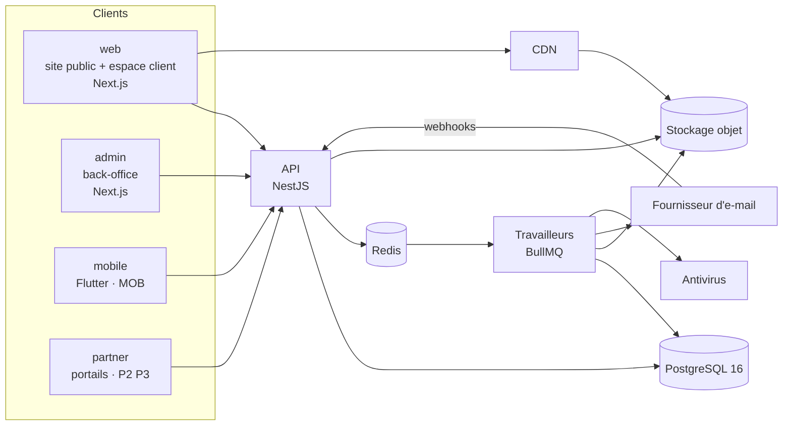

# Architecture

Pile technique : D-001 et D-050 à D-059. Ce fichier dit **comment le code est organisé** pour que chaque règle des specs ait une place évidente, et une seule.

---

## 1. Vue d'ensemble



**ARC-001** `[P1]` Une seule **API** porte toutes les règles métier. Les applications (web, admin, mobile, portails) n'en contiennent aucune : elles affichent, saisissent, et appellent l'API. Une règle codée dans une application est un défaut.

**ARC-002** `[P1]` **Dépôt unique** (D-050), géré par `pnpm` et Turborepo. TypeScript en mode strict partout. **Versions** : les versions majeures stables au démarrage du paquet 1.1, figées ensuite dans le dépôt (`engines`, fichiers de verrou) ; au minimum Node 22 LTS, PostgreSQL 16, Redis 7. Tests : Vitest ; bout en bout : Playwright ; boîte d'e-mails locale : Mailpit, ou des fichiers `.eml` (ENV-041). **Modules** : ECMAScript (ESM) partout — `apps/api` et `packages/*` compris —, NestJS 12 n'étant publié qu'en ESM (D-097).

```
apps/
  api/        NestJS : API et travailleurs (même code, deux modes de démarrage)
  web/        Next.js : site public et espace client
  admin/      Next.js : back-office
  mobile/     Flutter                                   [MOB]
  partner/    Next.js : portails promoteur et banque    [P2] [P3]
packages/
  contracts/  schémas de validation, types, énumérations, codes d'erreur, permissions
  domain/     fonctions pures : calculs, calendrier, complétude, libellés, cycles de vie
  i18n/       fichiers de traduction (clés de 07-design/03)
  ui/         composants React et jetons du système de design
  emails/     habillage des e-mails et gabarits des PDF
  config/     configuration partagée (lint, TypeScript, tests)
Specs/        spécifications (référence unique, D-002), avec _outils/verifier_specs.py (QUA-025)
```

## 2. API

**ARC-010** `[P1]` **Modules**, un par contexte du modèle (`01-domaine/01`, § 2) :

| Module | Contenu | Specs |
|---|---|---|
| `identity` | Comptes, sessions, jetons, double authentification, consentements, rôles et permissions | `03-espace-client/01`, `06-technique/03` |
| `referential` | Pays, régions, communes, taux de change, jours fériés, listes | `01-domaine/10` |
| `partners` | Promoteurs, banques, produits, contacts, documents | `04-back-office/04`, `05` |
| `catalogue` | Programmes, biens, lots, médias, complétude, publication | `04-back-office/04` |
| `crm` | Clients, demandes, notes, favoris, alertes | `04-back-office/03` |
| `dossiers` | Dossiers, emprunteurs, biens envisagés, réservations, rendez-vous | `04-back-office/06`, `09` |
| `documents` | Modèles de listes, pièces, fichiers | `04-back-office/07` |
| `financing` | Soumissions, paquets, liens de partage, simulations, projections | `04-back-office/05`, `01-domaine/07` |
| `communication` | Modèles, e-mails, messagerie, notifications | `01-domaine/09`, `04-back-office/08` |
| `automation` | Événements, règles, tâches planifiées, tâches du personnel | `01-domaine/08`, `04-back-office/09` |
| `events` | Cafés, inscriptions, pointage | `04-back-office/10` |
| `feedback` | Enquêtes, invitations, retours | `04-back-office/11` |
| `content` | Blocs, pages, questions fréquentes, témoignages, textes légaux, redirections | `04-back-office/12` |
| `reporting` | Indicateurs et rapports | `04-back-office/02` |
| `platform` | Paramètres, journal d'audit, boîte d'envoi, séquences, imports, exports, corbeille, diagnostic | `04-back-office/13`, `06-technique/04` |

**ARC-011** `[P1]` **Couches**, dans chaque module :

| Couche | Rôle | Interdits |
|---|---|---|
| Contrôleur | Reçoit la requête, vérifie l'accès, valide l'entrée, appelle un cas d'usage, met en forme la réponse. | Aucune règle métier. |
| Cas d'usage | Une action complète (« valider une pièce »). Ouvre **la** transaction, applique les règles, écrit, dépose les événements. | Aucun appel à un service externe dans la transaction. |
| Domaine | Les règles : gardes des transitions, calculs, complétude. Fonctions pures, dans `packages/domain`. | Aucun accès à la base ni au réseau. |
| Dépôt | L'accès aux données (Prisma). | Aucune règle. |

**ARC-012** `[P1]` **Cycles de vie.** Chaque objet à statut (`01-domaine/06`) a une **table de transitions** dans le code : pour chaque transition, son nom, les statuts de départ, le statut d'arrivée, la permission, ses gardes, ses effets. Un seul point d'entrée par objet exécute une transition. Aucun autre code ne modifie un champ de statut. Une transition absente de la table est refusée (`CONFLICT_STATE`).

**ARC-013** `[P1]` **Familles de routes**, chacune avec ses gardes :

| Préfixe | Pour | Accès |
|---|---|---|
| `/api/v1/public` | Site public, application mobile sans compte | Aucune session ; limites de débit ; réponses mises en cache |
| `/api/v1/auth` | Connexion, inscription, jetons | Selon la route |
| `/api/v1/client` | Espace client | Session d'un compte `CLIENT` vérifié ; ou session d'**aperçu** ouverte par un membre du personnel (ROL-017) : lectures seulement, sans effet de lecture |
| `/api/v1/admin` | Back-office | Session d'un compte `STAFF`, permission par route |
| `/api/v1/partner` `[P2]` `[P3]` | Portails (niveau 3 d'accès, `00-cadre/06`) | Session d'un compte `PARTNER` |
| `/api/v1/hooks` | Retours du fournisseur d'e-mail | Signature du fournisseur |

Avant ces gardes, deux barrières valent pour `/public`, `/auth` (audience client) et `/client` : la **porte d'accès** quand elle est fermée (`403 GATE_CLOSED`, NAV-064) et la **maintenance** (`503 MAINTENANCE`, NAV-061), avec leurs exceptions — dont `GET /public/settings/public`, que lisent la page d'attente et la page de maintenance (D-097). La famille `/partner` sert dès la Phase 1 l'espace partenaire du site (EP-33, API-100) ; le portail `[P2]` `[P3]` l'étendra.

**ARC-014** `[P1]` **Gestes de partenaire : la règle est dans la commande** (ACP-011, ACP-070). Chaque geste de `PartnerGesture` est un cas d'usage du module de son objet — réservations, soumissions, catalogue, pièces, rendez-vous. Il reçoit l'objet, les champs du geste et son auteur ; il valide, exécute la transition (ARC-012), écrit les journaux et émet les événements. En Phase 1, seul le back-office l'appelle, et le contrôleur ne fait rien d'autre : aucune règle d'un geste n'est écrite dans un contrôleur ni dans un écran (ARC-001). C'est tout ce que la Phase 1 doit aux niveaux 2 et 3 : le jour où ils s'ouvrent, le contrôleur des liens et celui du portail appellent le **même** cas d'usage — tout de suite pour un geste direct, à l'application d'une réponse relue sinon (ACP-031) — et lui passent leur voie (`GestureRoute`). La lecture d'un objet pour le compte d'un partenaire, qui retire ce qu'il n'a pas à connaître (ACP-017), s'écrit à ce moment-là, pas avant.

Une même donnée n'est jamais servie par la même route à deux publics : chaque famille a ses propres formes de réponse, qui ne contiennent que ce que ce public a le droit de voir.

## 3. Validation et contrats

**ARC-030** `[P1]` **Une seule définition par formulaire.** Chaque entrée de l'API est décrite par un schéma dans `packages/contracts`. Le même schéma valide la saisie dans le navigateur et la requête sur le serveur (TRV-060). Les énumérations, leurs libellés, les codes d'erreur et la table rôle → permissions y vivent aussi.

**ARC-031** `[P1]` L'API publie sa description **OpenAPI**, produite à partir de ces schémas. Le client Dart de l'application mobile en est généré. Une modification incompatible de l'API fait échouer l'intégration continue tant que la version n'est pas changée (API-090).

**ARC-032** `[P1]` Les fonctions de `packages/domain` sont accompagnées de tests qui reprennent, tels quels, les **exemples chiffrés** de `01-domaine/07`.

## 4. Applications web

**ARC-040** `[P1]` **`web`**. Next.js, routeur « App ». Les pages publiques sont rendues par le serveur et mises en cache avec des **étiquettes** (`home`, `catalogue`, `property:{id}`, `program:{id}`, `events`, `content`, `settings`) ; l'API invalide les étiquettes touchées quand une donnée change (NAV-042) : elle appelle `POST {WEB_URL}/api/revalidate` avec `{tags: [...]}`, signé par `REVALIDATE_SECRET` (ENV-040) ; un appel en échec est rejoué par la boîte d'envoi (FIA-040), et chaque page garde de toute façon une durée de vie de 60 secondes, qui borne le délai de NAV-042. L'espace client est rendu côté navigateur, derrière la session.

**ARC-041** `[P1]` **`admin`**. Next.js, rendu côté navigateur ; aucune page n'est mise en cache ni indexée.

**ARC-042** `[P1]` **Briques communes** (`packages/ui`) : composants accessibles construits sur des primitives sans style, habillés par les jetons du système de design (`07-design/01`) ; formulaires liés aux schémas de `contracts` ; tableaux, glisser-déposer, graphiques, carte (MapLibre, D-056), visionneuse de documents, visionneuse 360°. Le choix d'une bibliothèque se fait à l'intérieur de ce paquet : les applications n'en dépendent pas directement.

**ARC-043** `[P1]` **Textes.** Aucun texte visible dans le code (TRV-002) : les applications lisent `packages/i18n`. L'intégration continue échoue si une clé utilisée manque, ou si une clé n'est plus utilisée.

## 5. Travaux en arrière-plan

**ARC-050** `[P1]` Les **travailleurs** sont le même code que l'API, démarré en mode « travailleur » (`APP_ROLE`, ENV-040). Files (D-054) :

| File | Travaux |
|---|---|
| `outbox` | Diffusion des événements de domaine (FIA-040) |
| `automation` | Exécution des règles ; tâches planifiées (AUT-081). Livrée avec le socle : chaque module y ajoute ses règles et ses tâches (AUT-083) |
| `email` | Envoi des e-mails ; traitement des retours du fournisseur |
| `documents` | Contrôle antivirus ; réunion des images d'un dépôt en PDF (MED-032) ; aperçus ; paquets de soumission ; PDF |
| `media` | Déclinaisons d'images ; vues 360° |
| `recalc` | Recalcul des montants de référence (AUT-080) |
| `transfer` | Imports et exports |

**ARC-051** `[P1]` Tout travail est **rejouable** sans effet double (clés de AUT-005) et porte un nombre d'essais et un délai entre essais. Sauf règle propre (e-mail : NOT-010 ; antivirus : MED-035 ; boîte d'envoi : FIA-040 ; règles : AUT-004), c'est **5 essais**, espacés de 1 min, 5 min, 30 min et 2 h ; épuisés, l'objet concerné prend l'état d'échec que prévoit son module (`ProcessingStatus.FAILED` pour un média, avec sa raison ; `VersionOutcome.DISCARDED` pour une version de pièce ; `JobStatus.FAILED` pour un import ou un export). Un travail qui épuise ses essais reste visible dans le diagnostic (ADM-080) et déclenche une alerte (AUT-076).

**ARC-052** `[P1]` **Temps réel** (NOT-019) : l'API pousse les mises à jour vers les écrans ouverts par un flux d'événements (API-070), alimenté par Redis. Si le flux est indisponible, les écrans se rafraîchissent périodiquement : le temps réel est un confort, pas une condition de justesse.

## 6. Services extérieurs

**ARC-060** `[P1]` Chaque service extérieur est derrière une **interface**, avec une réalisation réelle et une réalisation de test :

| Interface | Rôle | Remarque |
|---|---|---|
| `MailProvider` | Envoyer un e-mail, recevoir ses statuts | D-055 ; choix du fournisseur : Q-030. Réalisations : le fournisseur retenu ; SMTP vers la boîte de test locale (`MAIL_PROVIDER` = `smtp`, ENV-040) ; un fichier `.eml` par e-mail (`log`, le défaut en local, ENV-041) ; en mémoire, pour les tests automatisés |
| `ObjectStorage` | Stocker, signer une adresse d'envoi ou de lecture | Compatible S3 ; en local, des dossiers du disque (ENV-041) |
| `VirusScanner` | Contrôler un fichier | ClamAV, dans un conteneur à part (`CLAMAV_HOST`, `CLAMAV_PORT`, ENV-040), signatures mises à jour chaque jour. En local seulement, sans ClamAV, un contrôle qui déclare tout fichier sain et le signale au journal ; ailleurs, sans antivirus, le résultat est une erreur et le fichier reste « en cours » (MED-035) |
| `AssistantModel` | Le modèle de langue de l'assistant conversationnel | ASS-052 ; une réalisation par fournisseur (`AI_PROVIDER`, Q-057) ; absente : mode guidé |
| `PdfRenderer` | Produire un PDF à partir d'un gabarit | TRV-142 |
| `ChallengeProvider` | Défi contre les robots | Facultatif (DEM-030) |
| `PushProvider` `[MOB]` | Notifications push | |
| `Clock` | L'heure courante | Permet aux tests de fixer la date, et à la recette de l'avancer (ENV-032). Aucun code ne lit l'heure du système autrement : échéances, tâches planifiées, expirations, durées de validité et horodatages (MOD-004) suivent tous cette horloge. En production, elle rend toujours l'heure réelle. Seuls les délais des files de travaux (ARC-050 : nouvel essai d'un e-mail, d'un contrôle antivirus…) suivent l'heure réelle. Tout ce qui est une date en base — `scheduledFor`, `availableAt` (y compris le nouvel essai d'un événement), `nextAttemptAt`, `claimedAt`, la ligne d'une clé d'idempotence, `dueAt` — est écrit et comparé selon `Clock`. Un décalage peut donc faire échoir d'un coup des réservations et des requêtes en cours, ce qui reste sans effet double (FIA-041, API-040) |

**ARC-061** `[P1]` Un service extérieur en panne **ne fait jamais échouer une action de l'utilisateur** qui n'en dépend pas directement : l'e-mail attend dans sa file, le contrôle antivirus reste « en cours », la demande est enregistrée (D-030).

## 7. Règles transverses du code

**ARC-070** `[P1]` **Temps.** Tout instant est en UTC en base et dans l'API (TRV-031). L'heure courante vient de `Clock`. Les calculs de temps ouvré passent par le module de calendrier (CAL-060).

**ARC-071** `[P1]` **Argent.** Un montant n'est jamais un nombre flottant : type décimal en base, bibliothèque décimale dans le code, chaîne dans l'API (API-002).

**ARC-072** `[P1]` **Configuration.** Les variables d'environnement sont validées au démarrage ; une variable manquante ou mal formée empêche le démarrage, avec un message clair (ENV-040). Aucun secret dans le dépôt.

**ARC-073** `[P1]` **Journaux.** Chaque requête porte un identifiant, repris dans tous ses journaux et rendu à l'utilisateur en cas d'erreur (TRV-111). Les journaux sont structurés et ne contiennent **aucune donnée personnelle** : ni e-mail, ni nom, ni contenu de message, ni jeton (SEC-081). Une adresse de page ou de route qui porte un jeton (`/activation/{jeton}`, `/partage/{jeton}`, `/preferences/{jeton}`…) y est écrite avec le jeton remplacé par `{jeton}` ; la même règle est réglée sur le CDN et le répartiteur (SEC-040).

**ARC-074** `[P1]` **Recherche.** Dans PostgreSQL (D-053) : colonnes de recherche générées, sans accents, indexées par trigrammes (MOD-015).

**ARC-075** `[P1]` **Cache.** Les paramètres et les lectures publiques fréquentes sont gardés dans Redis — et, tant que Redis n'est pas dans l'environnement, en mémoire de l'instance, comme les compteurs de SEC-070 (D-097). Toute écriture qui les touche les invalide dans la même opération. Aucune décision métier ne repose sur une valeur de cache : une transition relit toujours la base.

**ARC-080** `[MOB]` **Application mobile** : Flutter, canal stable ; navigation déclarative ; état géré par fournisseurs ; client d'API généré (ARC-031) ; stockage sécurisé du système pour le jeton ; mêmes clés de traduction que le web.
